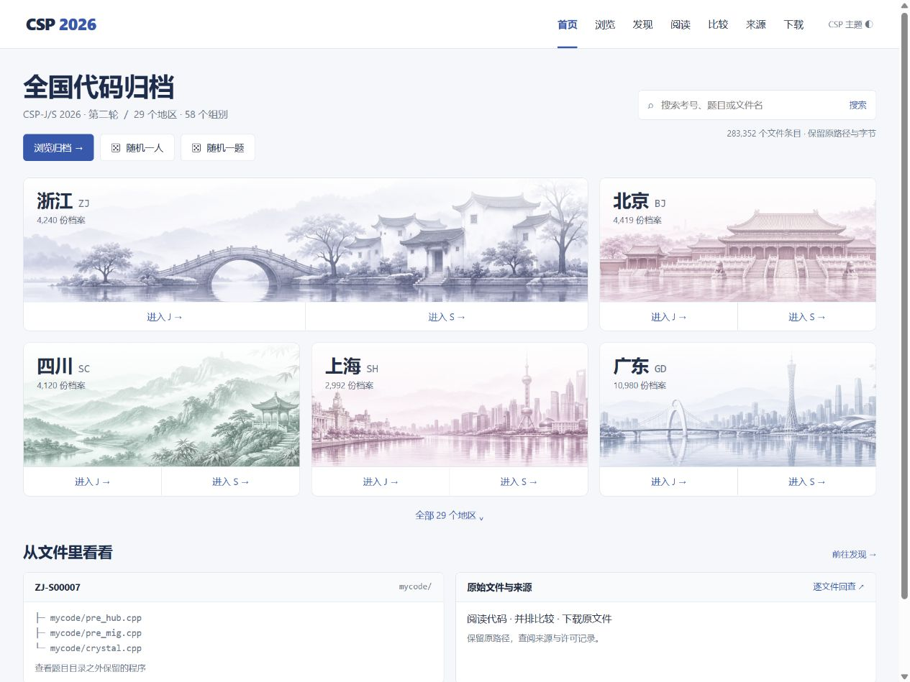

<p align="center"><picture><source media="(prefers-color-scheme: dark)" srcset="docs/assets/readme/logo-dark.svg"></picture></p>

<h1 align="center">CSP-2026</h1>

<p align="center">CSP-J/S 2026 papers and contestant files, ready to browse, compare and download.</p>

<p align="center"><a href="https://tangyixiao.github.io/CSP-2026/"><picture><source media="(prefers-color-scheme: dark)" srcset="docs/assets/readme/banner-en-dark.svg"></picture></a></p>

<p align="center"><a href="README.md">简体中文</a> · <a href="README.en.md">English</a></p>

<p align="center"><a href="https://github.com/tangyixiao/CSP-2026/stargazers"></a> <a href="https://github.com/tangyixiao/CSP-2026/actions/workflows/code-browser-pages.yml"></a> <a href="NOTICE"></a></p>

<p align="center">
  <picture><source media="(prefers-color-scheme: dark)" srcset="docs/assets/readme/feature-1-en-dark.svg"></picture>
  <picture><source media="(prefers-color-scheme: dark)" srcset="docs/assets/readme/feature-2-en-dark.svg"></picture>
  <picture><source media="(prefers-color-scheme: dark)" srcset="docs/assets/readme/feature-3-en-dark.svg"></picture>
</p>

CSP-J/S 2026 first-round papers and reference materials, second-round statements and contestant files for post-contest reading, comparison and study. Contestant files are organized by region, group, contestant ID and problem, with online reading and scoped downloads.

[Paper PDFs](https://tangyixiao.github.io/CSP-2026/papers/) · [Browse online](https://tangyixiao.github.io/CSP-2026/) · [Read and compare code](https://tangyixiao.github.io/CSP-2026/code/) · [Region downloads](https://tangyixiao.github.io/CSP-2026/preview/downloads.html) · [Sources](SOURCES.md) · [Contribute](CONTRIBUTING.md)



## First- and second-round papers

| Material | Read online | Repository copy | Edition |
| --- | --- | --- | --- |
| Round 1 · Junior J | [Open PDF](https://tangyixiao.github.io/CSP-2026/papers/round-1/csp-j-2026.pdf) | [9-page paper](papers/round-1/csp-j-2026.pdf) | Third-party public copy |
| Round 1 · Senior S | [Open PDF](https://tangyixiao.github.io/CSP-2026/papers/round-1/csp-s-2026-community.pdf) | [14-page paper and answers](papers/round-1/csp-s-2026-community.pdf) | Community typeset edition |
| Round 2 · Junior J | [Open PDF](https://tangyixiao.github.io/CSP-2026/papers/round-2/csp-j-2026.pdf) | [12-page statements](papers/round-2/csp-j-2026.pdf) | Gym Chinese reading edition |
| Round 2 · Senior S | [Open PDF](https://tangyixiao.github.io/CSP-2026/papers/round-2/csp-s-2026.pdf) | [12-page statements](papers/round-2/csp-s-2026.pdf) | Gym Chinese reading edition |

The [paper library](https://tangyixiao.github.io/CSP-2026/papers/) provides browser reading and PDF downloads. The [material guide](papers/README.md) also links first-round OCR, community reference answers and discussion, exam information, and second-round official test data. PDFs retain their downloaded bytes. The second-round reading editions use standard input/output; see the guide for edition differences, sources and checksums.

<a id="what-you-can-use-today"></a>

## Start here

Open the website to browse without installing anything:

| What you need | Where to start |
| --- | --- |
| Find a contestant or problem | Search the [archive homepage](https://tangyixiao.github.io/CSP-2026/), or select a region and J/S group in the [regional browser](https://tangyixiao.github.io/CSP-2026/code/browse.html?view=browse) |
| Read or compare code | Select a file in the [reader](https://tangyixiao.github.io/CSP-2026/code/); select two files for a side-by-side or inline diff |
| Download a file or contestant directory | Open a file and use the original-file or contestant-directory ZIP download |
| Save a region's materials | Choose a region on the [download page](https://tangyixiao.github.io/CSP-2026/preview/downloads.html) |
| Ask a question, discuss code or share materials | Use [Discussions](https://github.com/tangyixiao/CSP-2026/discussions); report a concrete file or website problem through [Issues](https://github.com/tangyixiao/CSP-2026/issues/new/choose) |

The reader supports syntax highlighting, changed-line navigation and shareable selections. Regional browsing includes sorting, random contestant and random problem actions. Project introduction pages provide Chinese and English with light, dark and system appearance. The website displays and downloads archived files; it does not compile or run contestant programs.

<a id="coverage-and-interpretation"></a>

## Second-round contestant files

Inventory checked on **2026-11-09**, at archive revision [`e55a367f`](https://github.com/tangyixiao/CSP-2026/commit/e55a367faa8b689ad26e152af821fdfce43c24b1):

| Catalog measure | Junior J | Senior S | Total |
| --- | ---: | ---: | ---: |
| Region/group directories | 29 | 29 | 58 |
| Paths classified as source or text | 168,484 | 114,868 | 283,352 |
| Contestant/group directory identifiers | 43,147 | 32,362 | 75,509 |

Both groups cover the same **29 regions**. These are directory-derived counts, not unique people or valid submissions. Backups, empty files, invalid code and source-named binary content may be present. This repository does not provide official scores. See [Sources](SOURCES.md) for regional completeness and verification scope.

Files usually follow `region/group/contestant/problem/file`. Original casing, unusual names, extensionless files and nested directories are retained. Some GitHub directory views display at most 1,000 entries; use the website or region downloads to browse complete directories.

<a id="regions-in-this-snapshot"></a>

<details>
<summary>Show repository directories for all 29 regions</summary>

| Region | Junior J | Senior S |
| --- | --- | --- |
| Anhui AH | [AH/J](AH/J) | [AH/S](AH/S) |
| Beijing BJ | [BJ/J](BJ/J) | [BJ/S](BJ/S) |
| Chongqing CQ | [CQ/J](CQ/J) | [CQ/S](CQ/S) |
| Fujian FJ | [FJ/J](FJ/J) | [FJ/S](FJ/S) |
| Gansu GS | [GS/J](GS/J) | [GS/S](GS/S) |
| Guangdong GD | [GD/J](GD/J) | [GD/S](GD/S) |
| Guangxi GX | [GX/J](GX/J) | [GX/S](GX/S) |
| Guizhou GZ | [GZ/J](GZ/J) | [GZ/S](GZ/S) |
| Hainan HI | [HI/J](HI/J) | [HI/S](HI/S) |
| Hebei HE | [HE/J](HE/J) | [HE/S](HE/S) |
| Heilongjiang HL | [HL/J](HL/J) | [HL/S](HL/S) |
| Henan HA | [HA/J](HA/J) | [HA/S](HA/S) |
| Hubei HB | [HB/J](HB/J) | [HB/S](HB/S) |
| Hunan HN | [HN/J](HN/J) | [HN/S](HN/S) |
| Inner Mongolia NM | [NM/J](NM/J) | [NM/S](NM/S) |
| Jiangsu JS | [JS/J](JS/J) | [JS/S](JS/S) |
| Jiangxi JX | [JX/J](JX/J) | [JX/S](JX/S) |
| Jilin JL | [JL/J](JL/J) | [JL/S](JL/S) |
| Liaoning LN | [LN/J](LN/J) | [LN/S](LN/S) |
| Qinghai QH | [QH/J](QH/J) | [QH/S](QH/S) |
| Shaanxi SN | [SN/J](SN/J) | [SN/S](SN/S) |
| Shandong SD | [SD/J](SD/J) | [SD/S](SD/S) |
| Shanghai SH | [SH/J](SH/J) | [SH/S](SH/S) |
| Shanxi SX | [SX/J](SX/J) | [SX/S](SX/S) |
| Sichuan SC | [SC/J](SC/J) | [SC/S](SC/S) |
| Tianjin TJ | [TJ/J](TJ/J) | [TJ/S](TJ/S) |
| Xinjiang XJ | [XJ/J](XJ/J) | [XJ/S](XJ/S) |
| Yunnan YN | [YN/J](YN/J) | [YN/S](YN/S) |
| Zhejiang ZJ | [ZJ/J](ZJ/J) | [ZJ/S](ZJ/S) |

</details>

<a id="choose-a-download-scope"></a>

## Downloads and local browsing

Single-file downloads preserve original bytes and filenames. A contestant ZIP includes the directory's tracked entries, including files outside the source preview catalog. Individual source previews are limited to **2 MiB**; browser-generated contestant ZIPs are limited to **64 MiB**. Use the original-file link or a region release for larger materials.

The published [`archive-2026-11-08`](https://github.com/tangyixiao/CSP-2026/releases/tag/archive-2026-11-08) release contains **29 region ZIPs**, `SHA256SUMS` and `release-index.json`. Its manifest defines that version's contents. Compare downloaded files' SHA-256 values with the checksum list when verification is needed. The download page offers GitHub direct links and an explicitly identified third-party acceleration service.

Some oversized sources use lossless `.gz` compression; decompress them to recover the original bytes. Git does not preserve empty directories. Zhejiang's original packages and answer summaries remain under `ZJ/J/` and `ZJ/S/`; the corresponding `answers.zip` restores the original package's empty-directory layout.

When version control is useful, check out only the region and group you need. For example, to browse Shanghai Senior:

```sh
git clone --filter=blob:none --sparse https://github.com/tangyixiao/CSP-2026.git
cd CSP-2026
git sparse-checkout set SH/S
```

Checking out a selected directory downloads its files. A full working copy contains many small files and may use substantially more disk space than the compressed archives. Expand the checkout as needed.

<a id="sources-verification-and-corrections"></a>

## Sources and interpretation

[SOURCES.md](SOURCES.md) indexes official publication links, supplied packages, regional verification records, public discussions and website assets. Official test data is retained under [Junior](test-data/J/official) and [Senior](test-data/S/official). Regional illustrations are AI-generated, with provenance recorded in the same source index.

Code comparisons show text or byte differences. Collected similarity materials retain their authors and original sources. An author's claims, computed differences and official findings have different meanings and are not interchangeable; consult the corresponding record for its sources and verification scope.

## Feedback and contributions

Chinese and English contributions are welcome. Include the region, J/S group, original path, archive revision and concrete evidence when reporting a problem:

| Topic | Entry point |
| --- | --- |
| Missing, damaged or conflicting files; website defects | [Issues](https://github.com/tangyixiao/CSP-2026/issues/new/choose) |
| Usage questions, additional materials, code discussion and corrections to discussion records | [Discussions](https://github.com/tangyixiao/CSP-2026/discussions) |
| Archive or website changes | Read the [contribution guide](CONTRIBUTING.md) and submit a pull request |
| Website or workflow vulnerabilities | Use the [private reporting entry](https://github.com/tangyixiao/CSP-2026/security/advisories/new) |

Preserve original filenames, paths and bytes when contributing archive materials. State their origin and the checks actually performed. Keep passwords, tokens and private correspondence out of public reports. Contributors using AI assistance remain responsible for understanding changes and verifying results. Repository execution agreements are in [AGENTS.md](AGENTS.md).

<a id="browsing-and-reading-review"></a>

## Website development

The website uses Node.js 22 or newer and npm. See the [website maintenance guide](website/README.md) for development commands, local previews, complete source snapshots and Pages packaging. In a partial clone, read its bounded-preview instructions before downloading the entire archive for a small change. Appearance and runtime verification records are in the [design record](docs/design/root-noi-classic-plus.md).

## Star History

<picture><source media="(prefers-color-scheme: dark)" srcset="https://api.star-history.com/chart?repos=tangyixiao/CSP-2026&amp;type=date&amp;theme=dark&amp;legend=top-left"></picture>

[Interactive chart](https://www.star-history.com/?repos=tangyixiao%2FCSP-2026&type=date) · [GitHub Stars](https://github.com/tangyixiao/CSP-2026/stargazers)

Star counts and history use real GitHub data displayed by external services and may be cached.

## License and attribution

Original website code, maintenance scripts, configuration and documentation in this repository are offered under [Apache-2.0](LICENSE), subject to the scope in [NOTICE](NOTICE).

Contestant files, papers and reference answers, official test data, original archive packages, quoted material, fonts and other third-party assets retain their respective rights and existing licenses. Their inclusion does not relicense them under the project's software license. See [SOURCES.md](SOURCES.md) and the [third-party license notices](website/public/third-party-licenses.txt).
