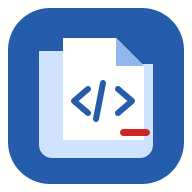
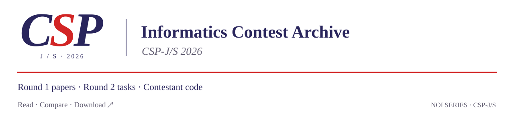
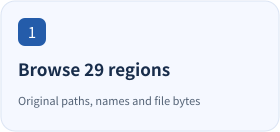
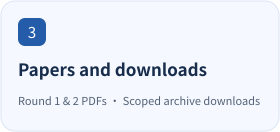
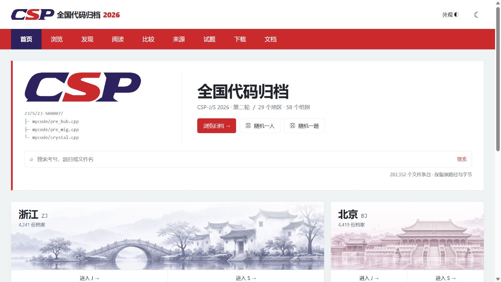

<p align="center"><picture><source media="(prefers-color-scheme: dark)" srcset="docs/assets/readme/logo-dark.svg"></picture></p>

<h1 align="center">CSP-2026</h1>

<p align="center">CSP-J/S 2026 papers and contestant files, ready to browse, compare and download.</p>

<p align="center"><a href="https://tangyixiao.github.io/CSP-2026/"><picture><source media="(prefers-color-scheme: dark)" srcset="docs/assets/readme/banner-en-dark.svg"></picture></a></p>

<p align="center"><a href="README.md">简体中文</a> · <a href="README.en.md">English</a></p>

<p align="center"><a href="https://github.com/tangyixiao/CSP-2026/stargazers"></a> <a href="https://github.com/tangyixiao/CSP-2026/actions/workflows/code-browser-pages.yml"></a> <a href="NOTICE"></a></p>

<p align="center">
  <picture><source media="(prefers-color-scheme: dark)" srcset="docs/assets/readme/feature-1-en-dark.svg"></picture>
  <picture><source media="(prefers-color-scheme: dark)" srcset="docs/assets/readme/feature-2-en-dark.svg"></picture>
  <picture><source media="(prefers-color-scheme: dark)" srcset="docs/assets/readme/feature-3-en-dark.svg"></picture>
</p>

CSP-J/S 2026 first-round papers and reference materials, second-round statements and contestant files for post-contest reading, comparison and study. Contestant files are organized by region, group, contestant ID and problem, with online reading and scoped downloads.

[Paper PDFs](https://tangyixiao.github.io/CSP-2026/papers/) · [Browse online](https://tangyixiao.github.io/CSP-2026/) · [Read and compare code](https://tangyixiao.github.io/CSP-2026/code/) · [Region downloads](https://tangyixiao.github.io/CSP-2026/preview/downloads.html) · [Sources](SOURCES.md) · [Contribute](CONTRIBUTING.md)

<a id="recent-updates"></a>

## Recent updates

| Date | Category | Published change | Record |
| --- | --- | --- | --- |
| 2026-11-13 | Archive materials | Replace Round 2 Gym PDFs with 13-page contest-layout copies | [PR #57](https://github.com/tangyixiao/CSP-2026/pull/57) |
| 2026-11-12 | Website | Shared compact random selection, cross-region reader scopes and direct search-hit navigation | [PR #66](https://github.com/tangyixiao/CSP-2026/pull/66) |
| 2026-11-12 | Website/docs | Task-based usage guide, explicit actions and actionable failure messages | [PR #65](https://github.com/tangyixiao/CSP-2026/pull/65) |
| 2026-11-12 | Website | Compact nationwide indexes, one Appearance menu and revised Chinese/English copy | [PR #64](https://github.com/tangyixiao/CSP-2026/pull/64) |
| 2026-11-08 | Archive release | 29 region ZIPs, checksums and release index | [Archive snapshot](https://github.com/tangyixiao/CSP-2026/releases/tag/archive-2026-11-08) |

[The full changelog](CHANGELOG.md) lists website/docs changes and archive materials separately. Inventory dates and revisions are recorded with the statistics below.



## First- and second-round papers

| Material | Read online | Repository copy | Edition |
| --- | --- | --- | --- |
| Round 1 · Junior J | [Open PDF](https://tangyixiao.github.io/CSP-2026/papers/round-1/csp-j-2026.pdf) | [9-page paper](papers/round-1/csp-j-2026.pdf) | Third-party public copy |
| Round 1 · Senior S | [Open PDF](https://tangyixiao.github.io/CSP-2026/papers/round-1/csp-s-2026-community.pdf) | [14-page paper and answers](papers/round-1/csp-s-2026-community.pdf) | Community typeset edition |
| Round 2 · Junior J | [Open PDF](https://tangyixiao.github.io/CSP-2026/papers/round-2/csp-j-2026.pdf) | [13-page statements](papers/round-2/csp-j-2026.pdf) | Contest layout with file I/O |
| Round 2 · Senior S | [Open PDF](https://tangyixiao.github.io/CSP-2026/papers/round-2/csp-s-2026.pdf) | [13-page statements](papers/round-2/csp-s-2026.pdf) | Contest layout with file I/O |

The [paper library](https://tangyixiao.github.io/CSP-2026/papers/) provides browser reading and PDF downloads. The [material guide](papers/README.md) also links first-round OCR, community reference answers and discussion, exam information, and second-round official test data. Round 2 PDFs preserve the contest layout and file I/O; see the guide for editions, sources and checksums.

<a id="what-you-can-use-today"></a>

## Start here

Open the website to browse without installing anything:

| What you need | Where to start |
| --- | --- |
| Find a contestant or problem | Search the [archive homepage](https://tangyixiao.github.io/CSP-2026/), or select a region and J/S group in the [archive browser](https://tangyixiao.github.io/CSP-2026/code/browse.html?view=browse) |
| Read or compare code | Select a file in the [reader](https://tangyixiao.github.io/CSP-2026/code/); select two files for a side-by-side or inline diff |
| Download a file or contestant directory | Use Download file in the reader for one file, or open a contestant folder and choose Download contestant directory ZIP |
| Save a region's materials | Choose a region on the [download page](https://tangyixiao.github.io/CSP-2026/preview/downloads.html) |
| Ask a question, discuss code or share materials | Use [Discussions](https://github.com/tangyixiao/CSP-2026/discussions); report a concrete file or website problem through [Issues](https://github.com/tangyixiao/CSP-2026/issues/new/choose) |

The reader supports syntax highlighting, changed-line navigation and shareable selections. The website displays and downloads archived files; it does not compile or run contestant programs.

<a id="faq"></a>

## FAQ

<details>
<summary>Why do some files open in hexadecimal?</summary>

Preview mode follows the bytes rather than only the extension. Recognized text opens in the text reader; binary content uses a read-only hexadecimal/ASCII view with offsets and 16 KiB pages. Use it to inspect file bytes and readable characters.

</details>

<details>
<summary>Does display formatting change copied or downloaded originals?</summary>

Original text is the default. Opt-in C/C++ formatting changes the reading/diff display. Copying uses the original decoded text; original downloads, Git blob verification and SHA-256 use the archived bytes. The complete `.clang-format` can be edited, imported or exported; Apply default configuration restores the bundled settings. Displayed line numbers and differences can change.

</details>

<details>
<summary>Why is only an original-file link available, or a ZIP download refused?</summary>

Online previews are limited to 2 MiB per file. Oversized entries show a concrete reason and retain an original-file link. Complete contestant ZIP creation in the browser is limited to 64 MiB; use a region release above that limit. Gzip expansion is bounded; failed or oversized expansion can fall back to archived compressed bytes or the original download.

</details>

<details>
<summary>How do I search, sort or compare across provinces?</summary>

Choose nationwide scope or selected provinces in the browser, then choose group, task and order. Sorting covers the complete selected scope. The reader offers the same scope controls, so files from different provinces can be selected as A and B. Opening files, switching reading/comparison and sharing links retain scope and search state; switching J/S resets incompatible task filters.

</details>

<details>
<summary>Why do file counts, directory counts and people counts differ?</summary>

Counts use archive paths at the stated revision. Files include backups, empty files and versions; contestant directories are counted separately for each group. People and valid submissions require separate records. Unknown sizes are labeled and sort last.

</details>

<details>
<summary>Are all paper PDFs authenticated official originals?</summary>

Round 2 J/S now provide 13-page contest-layout copies with covers, submission rules and file I/O, checked against contestant-distributed PDFs. Round 1 retains third-party and community references; original PDFs are still needed. See [verification progress](docs/verification-progress.md#papers) for official publication evidence.

</details>

<details>
<summary>Why does a task-filtered contestant folder still contain other files?</summary>

The outer filter selects contestant directories. Cards show matching files first and highlight search terms. Clicking a filename focuses that file in the complete folder tree, which retains other tasks, backups and nested folders. Batches default to 60 folders, with 120 and 240 options.

</details>

<a id="verification-progress"></a>

## Verification and collection progress

<details>
<summary>Recorded status and requested materials (reviewed 2026-11-12)</summary>

| Material | Recorded scope | Still needed |
| --- | --- | --- |
| Round 1 J/S original PDFs | The published library contains third-party/community copies | Original files and official publication entries |
| Round 2 J/S contest-layout PDFs | **Obtained, 13 pages each; supplied-package correspondence checks recorded**; see [details](docs/verification-progress.md#papers) | Available in the paper library; direct official publication entries still needed |
| Regional contestant files | 29 regions and 58 group catalogs; verification scope varies | Ningxia, Hong Kong and Macao J/S; original-publication and independent source records for existing regions |
| Official test data | J/S directories and official notice link recorded | Consolidated retrieval, checksum and source records |

[The detailed status table](docs/verification-progress.md) lists recorded publication entries, checks, status and missing materials, with evidence in [SOURCES.md](SOURCES.md) and [the paper guide](papers/README.md). Acquisition, package checks and publication progress are listed separately.

</details>

<a id="coverage-and-interpretation"></a>

## Second-round contestant files

Inventory checked on **2026-11-09**, at archive revision [`e55a367f`](https://github.com/tangyixiao/CSP-2026/commit/e55a367faa8b689ad26e152af821fdfce43c24b1):

| Catalog measure | Junior J | Senior S | Total |
| --- | ---: | ---: | ---: |
| Region/group directories | 29 | 29 | 58 |
| Paths classified as source or text | 168,484 | 114,868 | 283,352 |
| Contestant/group directory identifiers | 43,147 | 32,362 | 75,509 |

Both groups cover the same **29 regions**. Counts include backups, empty files, invalid code and binary content stored with source filenames. People and valid submissions require separate records. See [Sources](SOURCES.md) for each region's materials and source records.

Files usually follow `region/group/contestant/problem/file`. Original casing, unusual names, extensionless files and nested directories are retained. Some GitHub directory views display at most 1,000 entries; use the website or region downloads to browse complete directories.

<a id="regions-in-this-snapshot"></a>

<details>
<summary>Show repository directories for all 29 regions</summary>

| Region | Junior J | Senior S |
| --- | --- | --- |
| Anhui AH | [AH/J](AH/J) | [AH/S](AH/S) |
| Beijing BJ | [BJ/J](BJ/J) | [BJ/S](BJ/S) |
| Chongqing CQ | [CQ/J](CQ/J) | [CQ/S](CQ/S) |
| Fujian FJ | [FJ/J](FJ/J) | [FJ/S](FJ/S) |
| Gansu GS | [GS/J](GS/J) | [GS/S](GS/S) |
| Guangdong GD | [GD/J](GD/J) | [GD/S](GD/S) |
| Guangxi GX | [GX/J](GX/J) | [GX/S](GX/S) |
| Guizhou GZ | [GZ/J](GZ/J) | [GZ/S](GZ/S) |
| Hainan HI | [HI/J](HI/J) | [HI/S](HI/S) |
| Hebei HE | [HE/J](HE/J) | [HE/S](HE/S) |
| Heilongjiang HL | [HL/J](HL/J) | [HL/S](HL/S) |
| Henan HA | [HA/J](HA/J) | [HA/S](HA/S) |
| Hubei HB | [HB/J](HB/J) | [HB/S](HB/S) |
| Hunan HN | [HN/J](HN/J) | [HN/S](HN/S) |
| Inner Mongolia NM | [NM/J](NM/J) | [NM/S](NM/S) |
| Jiangsu JS | [JS/J](JS/J) | [JS/S](JS/S) |
| Jiangxi JX | [JX/J](JX/J) | [JX/S](JX/S) |
| Jilin JL | [JL/J](JL/J) | [JL/S](JL/S) |
| Liaoning LN | [LN/J](LN/J) | [LN/S](LN/S) |
| Qinghai QH | [QH/J](QH/J) | [QH/S](QH/S) |
| Shaanxi SN | [SN/J](SN/J) | [SN/S](SN/S) |
| Shandong SD | [SD/J](SD/J) | [SD/S](SD/S) |
| Shanghai SH | [SH/J](SH/J) | [SH/S](SH/S) |
| Shanxi SX | [SX/J](SX/J) | [SX/S](SX/S) |
| Sichuan SC | [SC/J](SC/J) | [SC/S](SC/S) |
| Tianjin TJ | [TJ/J](TJ/J) | [TJ/S](TJ/S) |
| Xinjiang XJ | [XJ/J](XJ/J) | [XJ/S](XJ/S) |
| Yunnan YN | [YN/J](YN/J) | [YN/S](YN/S) |
| Zhejiang ZJ | [ZJ/J](ZJ/J) | [ZJ/S](ZJ/S) |

</details>

<a id="choose-a-download-scope"></a>

## Downloads and local browsing

Single-file downloads preserve original bytes and filenames. A contestant ZIP contains all archived files in that directory, including files without an online preview. Individual source previews are limited to **2 MiB**; browser-generated contestant ZIPs are limited to **64 MiB**. Use the original-file link or a region release for larger materials.

The published [`archive-2026-11-08`](https://github.com/tangyixiao/CSP-2026/releases/tag/archive-2026-11-08) release contains **29 region ZIPs**, `SHA256SUMS` and `release-index.json`. Its manifest defines that version's contents. Compare downloaded files' SHA-256 values with the checksum list when verification is needed. The download page offers GitHub direct links and an explicitly identified third-party acceleration service.

Some oversized sources use lossless `.gz` compression; decompress them to recover the original bytes.

Git does not track empty directories. Extract the corresponding `answers.zip` to restore the official package's complete directory layout.

When version control is useful, check out only the region and group you need. For example, to browse Shanghai Senior:

```sh
git clone --filter=blob:none --sparse https://github.com/tangyixiao/CSP-2026.git
cd CSP-2026
git sparse-checkout set SH/S
```

Checking out a selected directory downloads its files. A full working copy contains many small files and may use substantially more disk space than the compressed archives. Expand the checkout as needed.

<details>
<summary>How do I verify SHA-256 after downloading?</summary>

Put the ZIP and `SHA256SUMS` from the same release in one directory. Copy the matching [PowerShell](docs/download-verification.md#powershell), [Linux](docs/download-verification.md#linux) or [macOS](docs/download-verification.md#macos) steps from [the verification guide](docs/download-verification.md). Each example checks only the chosen file; you do not need every ZIP listed in the manifest. If the digest differs, confirm the release and filename, then download again. Report persistent mismatches with release, filename and computed digest.

</details>

<a id="sources-verification-and-corrections"></a>

## Sources and interpretation

[SOURCES.md](SOURCES.md) indexes official publication links, supplied packages, regional verification records, public discussions and website assets. Official test data is retained under [Junior](test-data/J/official) and [Senior](test-data/S/official). Regional illustrations are AI-generated, with provenance recorded in the same source index.

Code comparisons show text or byte differences. Comparison materials link to their authors and original sources; each record states which checks have been completed.

## Feedback and contributions

Chinese and English contributions are welcome. Include the region, J/S group, original path, archive revision and concrete evidence when reporting a problem:

| Topic | Entry point |
| --- | --- |
| Missing, damaged or conflicting files; website defects | [Issues](https://github.com/tangyixiao/CSP-2026/issues/new/choose) |
| Usage questions, additional materials, code discussion and corrections to discussion records | [Discussions](https://github.com/tangyixiao/CSP-2026/discussions) |
| Archive or website changes | Read the [contribution guide](CONTRIBUTING.md) and submit a pull request |
| Website or workflow vulnerabilities | Use the [private reporting entry](https://github.com/tangyixiao/CSP-2026/security/advisories/new) |

Preserve original filenames, paths and bytes when contributing archive materials. State their origin and the checks actually performed. Keep passwords, tokens and private correspondence out of public reports. Contributors using AI assistance remain responsible for understanding changes and verifying results. Repository execution agreements are in [AGENTS.md](AGENTS.md).

<a id="browsing-and-reading-review"></a>

## Website development

The website uses Node.js 22 or newer and npm. See the [website maintenance guide](website/README.md) for development commands, local previews, complete source snapshots and Pages packaging. In a partial clone, read its bounded-preview instructions before downloading the entire archive for a small change. Appearance and runtime verification records are in the [design record](docs/design/root-noi-classic-plus.md).

<a id="maintainer-navigation"></a>

## Maintainer quick navigation

| Change | File |
| --- | --- |
| Logo vector paths | [website/shared/brand.js](website/shared/brand.js) |
| Navigation and header | [website/shared/site-header.js](website/shared/site-header.js) |
| Shared colors and layout | [website/shared/site-shell.css](website/shared/site-shell.css) |
| Default appearance and preferences | [website/shared/theme.js](website/shared/theme.js) |
| Default formatter configuration | [website/src/default-clang-format.txt](website/src/default-clang-format.txt) |
| Source index and paper manifest | [SOURCES.md](SOURCES.md) |

Per-paper source records live in [papers/sources.json](papers/sources.json); regional evidence is indexed by [SOURCES.md](SOURCES.md). See [the website maintenance guide](website/README.md) for complete development and packaging instructions.

## Star History

<picture><source media="(prefers-color-scheme: dark)" srcset="https://api.star-history.com/chart?repos=tangyixiao/CSP-2026&amp;type=date&amp;theme=dark&amp;legend=top-left"></picture>

[Interactive chart](https://www.star-history.com/?repos=tangyixiao%2FCSP-2026&type=date) · [GitHub Stars](https://github.com/tangyixiao/CSP-2026/stargazers)

Star counts and history use real GitHub data displayed by external services and may be cached.

## License and attribution

Original website code, maintenance scripts, configuration and documentation in this repository are offered under [Apache-2.0](LICENSE), subject to the scope in [NOTICE](NOTICE).

Contestant files, papers and reference answers, official test data, original archive packages, quoted material, fonts and other third-party assets retain their respective rights and existing licenses. Their inclusion does not relicense them under the project's software license. See [SOURCES.md](SOURCES.md) and the [third-party license notices](website/public/third-party-licenses.txt).
