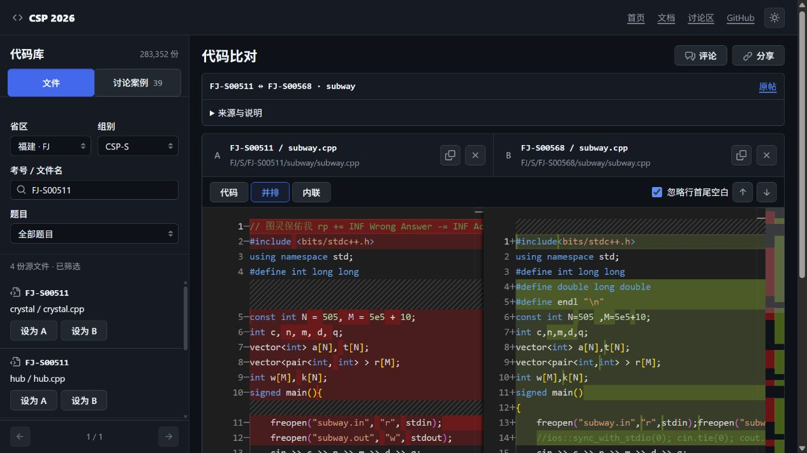

# CSP-2026

Contestant files from the second round of CSP-J/S 2026, preserved by region, group, contestant and problem. Read the original files in your browser, compare two versions, follow attributed discussion materials, or download only the part you need.

[Read and compare code](https://tangyixiao.github.io/CSP-2026/code/) · [Project website preview](https://tangyixiao.github.io/CSP-2026/preview/) · [Downloads](https://tangyixiao.github.io/CSP-2026/preview/downloads.html) · [Sources and attribution](SOURCES.md) · [Contribute](CONTRIBUTING.md)



## What you can use today

The code workbench searches region/group catalogs by contestant ID, problem or filename. It provides syntax highlighting, single-file reading, side-by-side and inline comparisons, changed-line navigation, and shareable selections. The displayed files come from a pinned same-origin byte snapshot; an original-file link remains available for independent inspection.

The project preview has four pages in Chinese and English, light/dark/system themes, and mobile layouts. Its download controls support GitHub direct links and an explicitly identified third-party acceleration service. The formal homepage remains separate while the new presentation is reviewed.

Download a single original file, a ZIP of one contestant directory, or one region archive containing the available J/S material. A contestant ZIP retains tracked filenames, relative paths and binary entries; it is limited to 64 MiB in the browser. Larger downloads use the region release. Files are preserved for study and provenance, not compiled or executed by this project.

Discussion materials retain their attributed claims and sources. Computed byte/text differences are a separate observation and do not establish misconduct. The embedded comments use GitHub/giscus; enabling Discussions is not proof that an external visitor's sign-in and posting flow has been fully verified.

## Coverage and interpretation

Directory inventory checked on **2026-11-09**, using archive revision [`e55a367f`](https://github.com/tangyixiao/CSP-2026/commit/e55a367faa8b689ad26e152af821fdfce43c24b1):

| Catalog measure | Junior (J) | Senior (S) | Total |
| --- | ---: | ---: | ---: |
| Region/group catalogs | 29 | 29 | 58 |
| Source-like or text paths | 168,484 | 114,868 | 283,352 |
| Contestant/group directory identifiers | 43,147 | 32,362 | 75,509 |

Both groups cover the same **29 regions**. These are directory-derived counts, not verified valid submissions or unique people. Backups, empty files, invalid code and source-named binary content may be present. Availability in this archive does not establish complete regional coverage, official authenticity or redistribution permission. This repository does not contain official scores.

The directory layout is usually `region/group/contestant/problem/file`. Original casing, unusual names, extensionless files and nested directories are retained. GitHub shows at most 1,000 entries in some directory views; for example, Shanghai Senior has 1,505 contestant directories through `SH-S01518`. Use the workbench or region downloads to browse beyond the GitHub listing limit.

## Choose a download scope

| Need | Entry point | Notes |
| --- | --- | --- |
| Read a file without cloning | [Code workbench](https://tangyixiao.github.io/CSP-2026/code/) | Preview limits apply to unusually large or unsupported files |
| Save one original file | Select the file, then **Download file** | Preserves original bytes and filename |
| Save one contestant directory | Select any of its files, then **Download contestant directory ZIP** | Includes tracked entries outside the source preview catalog |
| Save a region | [Region downloads](https://tangyixiao.github.io/CSP-2026/preview/downloads.html) | J/S material available in that release |
| Verify an archive | [Archive release](https://github.com/tangyixiao/CSP-2026/releases/tag/archive-2026-11-08) | 29 region ZIPs, `SHA256SUMS` and `release-index.json` |

Some oversized sources use a lossless `.gz` suffix; decompress to recover the original bytes. Git does not preserve empty directories. Original Zhejiang packages and answer summaries are retained under `ZJ/J/` and `ZJ/S/`; extracting the corresponding `answers.zip` restores the package's empty-directory layout.

Use sparse checkout when version control is useful; a full working copy contains many small files and can require substantially more disk space than the compressed download:

```sh
git clone --filter=blob:none --sparse https://github.com/tangyixiao/CSP-2026.git
cd CSP-2026
git sparse-checkout add /SH/S/
```

Adding a large region hydrates its selected files. Check available space before expanding the checkout.

## Regions in this snapshot

| Region | Junior | Senior |
| --- | --- | --- |
| Anhui (AH) | [AH/J](AH/J) | [AH/S](AH/S) |
| Beijing (BJ) | [BJ/J](BJ/J) | [BJ/S](BJ/S) |
| Chongqing (CQ) | [CQ/J](CQ/J) | [CQ/S](CQ/S) |
| Fujian (FJ) | [FJ/J](FJ/J) | [FJ/S](FJ/S) |
| Gansu (GS) | [GS/J](GS/J) | [GS/S](GS/S) |
| Guangdong (GD) | [GD/J](GD/J) | [GD/S](GD/S) |
| Guangxi (GX) | [GX/J](GX/J) | [GX/S](GX/S) |
| Guizhou (GZ) | [GZ/J](GZ/J) | [GZ/S](GZ/S) |
| Hainan (HI) | [HI/J](HI/J) | [HI/S](HI/S) |
| Hebei (HE) | [HE/J](HE/J) | [HE/S](HE/S) |
| Heilongjiang (HL) | [HL/J](HL/J) | [HL/S](HL/S) |
| Henan (HA) | [HA/J](HA/J) | [HA/S](HA/S) |
| Hubei (HB) | [HB/J](HB/J) | [HB/S](HB/S) |
| Hunan (HN) | [HN/J](HN/J) | [HN/S](HN/S) |
| Inner Mongolia (NM) | [NM/J](NM/J) | [NM/S](NM/S) |
| Jiangsu (JS) | [JS/J](JS/J) | [JS/S](JS/S) |
| Jiangxi (JX) | [JX/J](JX/J) | [JX/S](JX/S) |
| Jilin (JL) | [JL/J](JL/J) | [JL/S](JL/S) |
| Liaoning (LN) | [LN/J](LN/J) | [LN/S](LN/S) |
| Qinghai (QH) | [QH/J](QH/J) | [QH/S](QH/S) |
| Shaanxi (SN) | [SN/J](SN/J) | [SN/S](SN/S) |
| Shandong (SD) | [SD/J](SD/J) | [SD/S](SD/S) |
| Shanghai (SH) | [SH/J](SH/J) | [SH/S](SH/S) |
| Shanxi (SX) | [SX/J](SX/J) | [SX/S](SX/S) |
| Sichuan (SC) | [SC/J](SC/J) | [SC/S](SC/S) |
| Tianjin (TJ) | [TJ/J](TJ/J) | [TJ/S](TJ/S) |
| Xinjiang (XJ) | [XJ/J](XJ/J) | [XJ/S](XJ/S) |
| Yunnan (YN) | [YN/J](YN/J) | [YN/S](YN/S) |
| Zhejiang (ZJ) | [ZJ/J](ZJ/J) | [ZJ/S](ZJ/S) |

## Sources, verification and corrections

[SOURCES.md](SOURCES.md) indexes official announcements, supplied-package records, attributed Luogu materials, the website's origin and third-party assets. It distinguishes original publication evidence, a matching supplied package and an independently inspected code difference. Two comparison records currently have attributed excerpts without an original permalink; that gap is disclosed rather than filled with a guessed URL.

Zhejiang Junior was compared file by file with its official package. Guangxi Senior was compared with a locally supplied decrypted archive whose original distributor has not been independently verified. Hebei J/S were checked against supplied packages and MD5 manifests. Hainan J, Chongqing J/S and Qinghai J/S have their own source records. Verification is not a blanket claim for the remaining regions.

Official test data is retained under [test-data/J/official](test-data/J/official) and [test-data/S/official](test-data/S/official). A public source link or a matching checksum does not itself grant reuse rights.

To report an issue, include the region/group, original path, source revision and concrete difference. Use [Issues](https://github.com/tangyixiao/CSP-2026/issues/new/choose) for file or website defects and [Discussions](https://github.com/tangyixiao/CSP-2026/discussions) for contextual observations. Follow [CONTRIBUTING.md](CONTRIBUTING.md); send security reports through the [private reporting entry](https://github.com/tangyixiao/CSP-2026/security/advisories/new).

## Website development

The website is a static build with Monaco, Primer and giscus. The [maintenance guide](website/README.md) describes catalog generation, source snapshots, complete-build requirements and Pages packaging. Node.js 22 or newer and npm are used by this project.

```sh
npm ci --prefix website
npm test --prefix website
npm run build --prefix website
node website/scripts/package-site.mjs
```

A full source-pack build needs the indexed blobs. Use CI or an already complete environment; do not expand a partial clone merely to inspect documentation. Local tests, a complete build, CI, deployment and live use are separate verification steps.

## Proposed browsing improvements

A coordinated [DSH implementation brief](outputs/csp2026-national-review/dsh-handoff.zh-CN.md) records ownership, parallel work, review gates and safe startup in the existing partial checkout. The optional NOI website reference theme is separate from the NOI Linux editor reading views and is not the default.

A [desktop/mobile overview and interaction proposal](docs/design/province-browser-review.md) is available for review. It covers continuous region browsing, dedicated spacious reading/comparison pages, random-person and random-problem navigation, sorting, regional visual identities and visible provenance. It also proposes manually selected Windows/NOI Linux editor-style reading views, prioritizing Dev-C++; the modern CSP reader remains the default and borrows useful VS Code ergonomics without cloning its entire interface. **This is a proposal, not a description of deployed features.** Current catalogs do not have complete byte sizes; discussion-count sorting is not implemented. The Discussions API returned zero discussions on 2026-11-09, which is distinct from the 39 attributed comparison records.

## License and attribution

Repository-owned website code, maintenance scripts, configuration and original documentation are offered under [Apache-2.0](LICENSE), subject to the scope in [NOTICE](NOTICE). Existing third-party notices and licenses remain in force.

**Contestant files, official test data, original archive packages, copied source responses, quoted posts, fonts and other third-party assets are excluded from that project-code grant.** They retain their respective rights and any independently documented terms. Archiving or citing material does not relicense it. See [SOURCES.md](SOURCES.md), [NOTICE](NOTICE), the [component license notices](website/public/third-party-licenses.txt) and the font licenses distributed with the font files.
