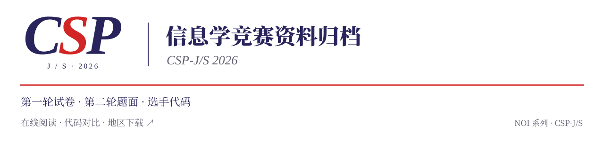

<p align="center"><picture><source media="(prefers-color-scheme: dark)" srcset="docs/assets/readme/logo-dark.svg"></picture></p>

<h1 align="center">CSP-2026</h1>

<p align="center">CSP-J/S 2026 试题与选手文件归档，在线阅读、对比与下载。</p>

<p align="center"><a href="https://tangyixiao.github.io/CSP-2026/"><picture><source media="(prefers-color-scheme: dark)" srcset="docs/assets/readme/banner-zh-CN-dark.svg"></picture></a></p>

<p align="center"><a href="README.md">简体中文</a> · <a href="README.en.md">English</a></p>

<p align="center"><a href="https://github.com/tangyixiao/CSP-2026/stargazers"></a> <a href="https://github.com/tangyixiao/CSP-2026/actions/workflows/code-browser-pages.yml"></a> <a href="NOTICE"></a></p>

<p align="center">
  <picture><source media="(prefers-color-scheme: dark)" srcset="docs/assets/readme/feature-1-zh-CN-dark.svg"></picture>
  <picture><source media="(prefers-color-scheme: dark)" srcset="docs/assets/readme/feature-2-zh-CN-dark.svg"></picture>
  <picture><source media="(prefers-color-scheme: dark)" srcset="docs/assets/readme/feature-3-zh-CN-dark.svg"></picture>
</p>

归档 CSP-J/S 2026 第一轮试卷与参考资料、第二轮题面和选手文件，供赛后阅读、对比与学习。选手文件按地区、组别、选手编号和题目整理，可在线查看或按需下载。

[试题 PDF](https://tangyixiao.github.io/CSP-2026/papers/) · [在线浏览](https://tangyixiao.github.io/CSP-2026/) · [代码阅读与对比](https://tangyixiao.github.io/CSP-2026/code/) · [分地区下载](https://tangyixiao.github.io/CSP-2026/preview/downloads.html) · [资料来源](SOURCES.md) · [参与贡献](CONTRIBUTING.md)


## 第一轮与第二轮试题

| 资料 | 在线阅读 | 仓库副本 | 版本说明 |
| --- | --- | --- | --- |
| 第一轮 · 入门组 J | [打开 PDF](https://tangyixiao.github.io/CSP-2026/papers/round-1/csp-j-2026.pdf) | [9 页试卷](papers/round-1/csp-j-2026.pdf) | 第三方公开副本 |
| 第一轮 · 提高组 S | [打开 PDF](https://tangyixiao.github.io/CSP-2026/papers/round-1/csp-s-2026-community.pdf) | [14 页试卷与答案](papers/round-1/csp-s-2026-community.pdf) | 社区排印版 |
| 第二轮 · 入门组 J | [打开 PDF](https://tangyixiao.github.io/CSP-2026/papers/round-2/csp-j-2026.pdf) | [12 页题面](papers/round-2/csp-j-2026.pdf) | Gym 中文阅读版 |
| 第二轮 · 提高组 S | [打开 PDF](https://tangyixiao.github.io/CSP-2026/papers/round-2/csp-s-2026.pdf) | [12 页题面](papers/round-2/csp-s-2026.pdf) | Gym 中文阅读版 |

[试题资料页](https://tangyixiao.github.io/CSP-2026/papers/)提供浏览器阅读和 PDF 下载；[资料说明](papers/README.md)另列第一轮题面 OCR、参考答案与讨论、考试信息及第二轮官方测试数据。PDF 保留原站下载字节。第二轮阅读版使用标准输入输出，版本差异、来源和校验值见资料说明。

<a id="what-you-can-use-today"></a>

## 开始使用

无需安装，打开网站即可浏览：

| 想做什么 | 从哪里开始 |
| --- | --- |
| 找到某位选手或一道题 | 在[归档首页](https://tangyixiao.github.io/CSP-2026/)搜索，或进入[地区浏览](https://tangyixiao.github.io/CSP-2026/code/browse.html?view=browse)选择地区和 J/S 组别 |
| 阅读或对比代码 | 在[阅读器](https://tangyixiao.github.io/CSP-2026/code/)中选择文件；选取两份文件后查看并排或行内差异 |
| 下载一个文件或选手目录 | 打开文件后，使用原文件下载或选手目录 ZIP 下载 |
| 保存某个地区的材料 | 打开[下载页](https://tangyixiao.github.io/CSP-2026/preview/downloads.html)，选择对应地区 |
| 提问、交流或补充资料 | 前往 [Discussions](https://github.com/tangyixiao/CSP-2026/discussions)；明确的文件或网站问题请提 [Issue](https://github.com/tangyixiao/CSP-2026/issues/new/choose) |

阅读器支持语法高亮、差异行跳转和可分享的选区链接。网站只展示和下载归档文件，不编译或运行选手程序。

- **选手文件夹与范围筛选**：每位选手以原始目录显示为文件夹，进入后可查看全部文件和嵌套目录。支持全国汇总、固定省份及自选多个省份；搜索与排序统一作用于整个选定范围。默认每批 60 个文件夹，可切换为 120 或 240 个。
- **题目与文件阅读**：J/S 组别各自显示对应题目，切换组别会清除不兼容的题目筛选。无扩展名文件按内容识别；二进制内容可通过分页十六进制／ASCII 视图查看。单文件快照上限仍为 2 MiB。
- **默认显示原文**：C/C++ 格式化需要手动开启。完整 `.clang-format` 内容可以编辑、校验、导入、导出及恢复默认；复制、下载和字节校验始终使用归档原文件。
- **统一外观**：首页、浏览、发现、阅读／比较、来源、试题、下载、文档和英文页共用导航、明暗设置与 SVG 字标。C、S、P 等高，浅色／深色版本支持无损缩放。新访客默认使用红色导航的 NOI 参考外观，已有外观偏好会保留。

<a id="coverage-and-interpretation"></a>

## 第二轮选手文件

以下统计的核对日期为 **2026-11-09**，对应归档版本 [`e55a367f`](https://github.com/tangyixiao/CSP-2026/commit/e55a367faa8b689ad26e152af821fdfce43c24b1)：

| 统计口径 | 入门组 J | 提高组 S | 合计 |
| --- | ---: | ---: | ---: |
| 地区／组别目录 | 29 | 29 | 58 |
| 按路径分类的源码或文本条目 | 168,484 | 114,868 | 283,352 |
| 选手／组别目录标识 | 43,147 | 32,362 | 75,509 |

J/S 两组均涉及同一批 **29 个地区**。这些数字来自目录统计，不能直接当作独立人数或有效提交数；归档中可能有备份、空文件、无效代码及使用源码文件名的二进制内容。本仓库不提供官方成绩，各地区材料的完整程度和来源核验程度见[来源说明](SOURCES.md)。

文件通常按 `地区/组别/选手编号/题目/文件` 保存，保留原始大小写、特殊名称、无扩展名文件和嵌套目录。GitHub 的部分目录页面最多显示 1,000 个条目，浏览完整目录请使用网站或地区下载包。

<a id="regions-in-this-snapshot"></a>

<details>
<summary>展开 29 个地区的仓库目录</summary>

| 地区 | 入门组 J | 提高组 S |
| --- | --- | --- |
| 安徽 AH | [AH/J](AH/J) | [AH/S](AH/S) |
| 北京 BJ | [BJ/J](BJ/J) | [BJ/S](BJ/S) |
| 重庆 CQ | [CQ/J](CQ/J) | [CQ/S](CQ/S) |
| 福建 FJ | [FJ/J](FJ/J) | [FJ/S](FJ/S) |
| 甘肃 GS | [GS/J](GS/J) | [GS/S](GS/S) |
| 广东 GD | [GD/J](GD/J) | [GD/S](GD/S) |
| 广西 GX | [GX/J](GX/J) | [GX/S](GX/S) |
| 贵州 GZ | [GZ/J](GZ/J) | [GZ/S](GZ/S) |
| 海南 HI | [HI/J](HI/J) | [HI/S](HI/S) |
| 河北 HE | [HE/J](HE/J) | [HE/S](HE/S) |
| 黑龙江 HL | [HL/J](HL/J) | [HL/S](HL/S) |
| 河南 HA | [HA/J](HA/J) | [HA/S](HA/S) |
| 湖北 HB | [HB/J](HB/J) | [HB/S](HB/S) |
| 湖南 HN | [HN/J](HN/J) | [HN/S](HN/S) |
| 内蒙古 NM | [NM/J](NM/J) | [NM/S](NM/S) |
| 江苏 JS | [JS/J](JS/J) | [JS/S](JS/S) |
| 江西 JX | [JX/J](JX/J) | [JX/S](JX/S) |
| 吉林 JL | [JL/J](JL/J) | [JL/S](JL/S) |
| 辽宁 LN | [LN/J](LN/J) | [LN/S](LN/S) |
| 青海 QH | [QH/J](QH/J) | [QH/S](QH/S) |
| 陕西 SN | [SN/J](SN/J) | [SN/S](SN/S) |
| 山东 SD | [SD/J](SD/J) | [SD/S](SD/S) |
| 上海 SH | [SH/J](SH/J) | [SH/S](SH/S) |
| 山西 SX | [SX/J](SX/J) | [SX/S](SX/S) |
| 四川 SC | [SC/J](SC/J) | [SC/S](SC/S) |
| 天津 TJ | [TJ/J](TJ/J) | [TJ/S](TJ/S) |
| 新疆 XJ | [XJ/J](XJ/J) | [XJ/S](XJ/S) |
| 云南 YN | [YN/J](YN/J) | [YN/S](YN/S) |
| 浙江 ZJ | [ZJ/J](ZJ/J) | [ZJ/S](ZJ/S) |

</details>

<a id="choose-a-download-scope"></a>

## 下载与本地查看

单文件下载保留原始字节和文件名；选手目录 ZIP 包含该目录在归档中的已跟踪文件，包括未进入源码预览目录的其他文件。单文件预览上限为 **2 MiB**，浏览器生成选手目录 ZIP 的上限为 **64 MiB**；超出时请使用原文件链接或地区发布包。

已发布的 [`archive-2026-11-08`](https://github.com/tangyixiao/CSP-2026/releases/tag/archive-2026-11-08) 提供 **29 个地区 ZIP**、`SHA256SUMS` 和 `release-index.json`。下载内容以该版本的清单为准；需要校验时，将文件的 SHA-256 与清单比对。下载页同时提供 GitHub 直连和标明服务来源的第三方加速入口。

部分较大的源码使用无损 `.gz` 压缩，解压即可恢复原始字节。Git 不保存空目录；浙江原始包和答卷汇总保留在 `ZJ/J/`、`ZJ/S/`，对应的 `answers.zip` 可恢复原始包的空目录结构。

需要 Git 版本管理时，可以只检出一个地区和组别。例如查看上海提高组：

```sh
git clone --filter=blob:none --sparse https://github.com/tangyixiao/CSP-2026.git
cd CSP-2026
git sparse-checkout set SH/S
```

检出所选目录会下载对应文件。完整工作副本包含大量小文件，占用空间可能明显大于压缩包，请按需扩大检出范围。

<a id="sources-verification-and-corrections"></a>

## 来源与资料解读

[SOURCES.md](SOURCES.md) 汇总官方发布入口、提供者交付的材料包、地区核验记录、公开讨论及网站素材来源。官方测试数据分别保存在 [J 组](test-data/J/official)和 [S 组](test-data/S/official)。地区插画为 AI 生成，其来源记录也在该文档中。

代码对比展示文本或字节差异，收录的相似代码资料保留作者和原始来源。原帖观点、对比结果与官方认定各有不同含义，不能相互替代；完整来源和核验范围请查看对应记录。

## 反馈与贡献

欢迎中文和英文贡献。报告问题时，请附上地区、J/S 组别、原始路径、归档版本及具体证据：

| 事项 | 入口 |
| --- | --- |
| 文件缺失、损坏、版本冲突或网站故障 | [Issues](https://github.com/tangyixiao/CSP-2026/issues/new/choose) |
| 使用提问、资料补充、代码交流与讨论记录订正 | [Discussions](https://github.com/tangyixiao/CSP-2026/discussions) |
| 提交文件或网站修改 | 阅读[贡献指南](CONTRIBUTING.md)，通过 Pull Request 提交 |
| 网站或工作流的安全问题 | 使用[私密报告入口](https://github.com/tangyixiao/CSP-2026/security/advisories/new) |

提交归档材料时保留原始名称、路径和字节，并说明来源与实际完成的核验。公开报告请勿包含密码、令牌或私人通信。使用 AI 辅助贡献时，贡献者仍需理解修改并核实结果；仓库内的执行约定见 [AGENTS.md](AGENTS.md)。

<a id="browsing-and-reading-review"></a>

<a id="website-development"></a>

## 网站开发

网站使用 Node.js 22 及以上版本和 npm。开发命令、本地预览、完整源码快照构建及 Pages 打包步骤见[网站维护指南](website/README.md)。部分克隆环境请先阅读其中的受限预览方法，避免为小范围修改下载全部归档。外观设计与运行核验记录见[设计记录](docs/design/root-noi-classic-plus.md)。

## Star History

<picture><source media="(prefers-color-scheme: dark)" srcset="https://api.star-history.com/chart?repos=tangyixiao/CSP-2026&amp;type=date&amp;theme=dark&amp;legend=top-left"></picture>

[交互式历史曲线](https://www.star-history.com/?repos=tangyixiao%2FCSP-2026&type=date) · [GitHub Stars](https://github.com/tangyixiao/CSP-2026/stargazers)

Star 数量与历史曲线使用真实 GitHub 数据，由外部服务展示，可能存在缓存延迟。

<a id="license-and-attribution"></a>

## 许可与署名

本仓库原创的网站代码、维护脚本、配置和文档采用 [Apache-2.0](LICENSE)，具体范围见 [NOTICE](NOTICE)。

选手文件、试卷与参考答案、官方测试数据、原始归档包、引用内容、字体及其他第三方素材保留各自权利和已有许可，不因收录而改用本项目的软件许可。详细来源和组件声明见 [SOURCES.md](SOURCES.md)及[第三方许可清单](website/public/third-party-licenses.txt)。
