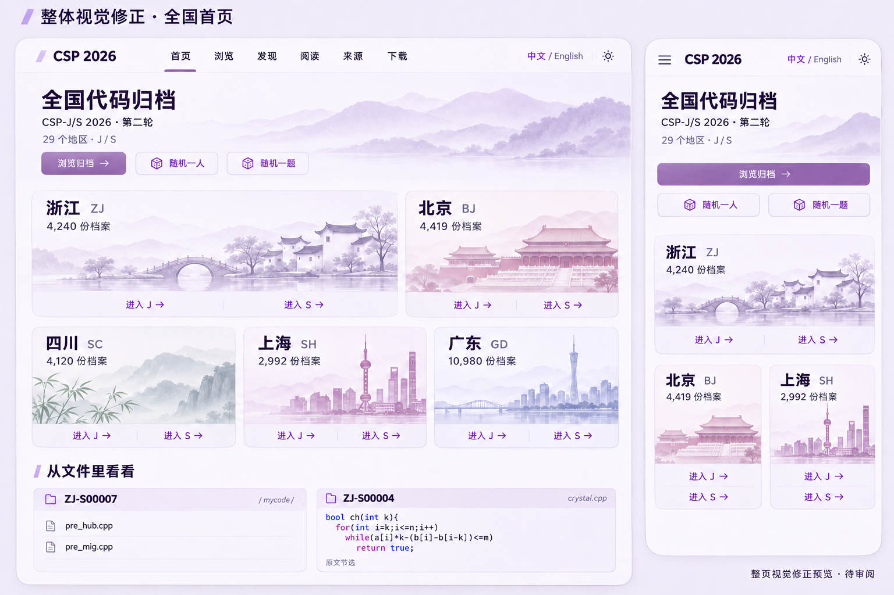
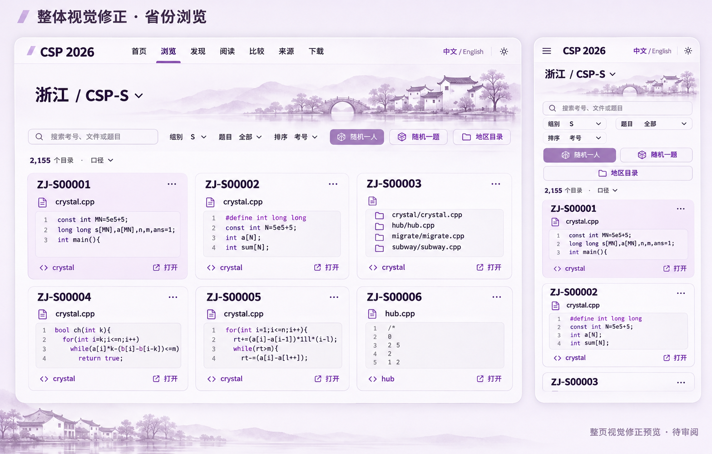

# CSP browser and reading-view review

Status, 2026-11-10: the maintainer has approved the illustrated home and province-browser compositions and authorized implementation. The current revision integrates that visual language across browsing, reading/comparison and sources. All 29 independent regional raster assets are present and validated. Local functional, frontend-build and desktop/mobile checks have passed as recorded below; current CI and deployment remain separate integration outcomes. This document does not claim a published result for this revision. Code::Blocks and a completed nationwide content study remain outside the completed website work.

## Approved illustrated direction

These are the selected generated design boards, not screenshots of deployed pages. They establish a coherent pale editorial presentation, softly shaded regional panoramas, spacious content blocks, limited repeated text and real archive entry points. Browse, reader and source views use the same typography, surfaces and restrained accents. The code reader keeps code dominant; a scenic illustration must not reduce its reading space. Desktop and mobile validation must use actual Chinese text, actual archive content and the selected boards.

The earlier `national-home-review.png`, `regional-browser-calibration.png` and `reading-view-presets.png` record superseded discussion. Earlier `runtime-home-desktop.jpg` and `runtime-reader-desktop.jpg` show the previous running implementation, before this illustrated revision. Neither those images nor the rejected uniform problem-icon cards are final acceptance evidence for the current design. Do not revert to the narrow province rail, permanent bottom provenance band, spreadsheet shell, bright tourism-postcard cartoons or crude SVG line symbols.

The review entry is `code/browse.html`; `code/` is the separate reader/comparison entry. The original formal homepage stays at the site root. Local partial-checkout previews may stream the existing published source buckets on demand without hydrating the archive, with Git-byte verification retained. Complete source packaging and full size coverage belong to the complete CI build.

[The DSH brief](../../outputs/csp2026-national-review/dsh-handoff.zh-CN.md) assigns nationwide source research, distinctive-material discovery, evidence and statistics to DSH/DeepSeek. Codex coordinates the project and implements the website/tools. That division remains unchanged; no article is being written as part of this visual revision.

## Regional asset record and checks

The project generated 29 separate panoramic illustrations through OpenAI's built-in `image_gen` tool on 2026-11-10. [The public manifest](../../website/src/assets/regions/manifest.json) records the shared prompt, generator, each region's subject/palette and its WebP filename. Each region has its own real raster asset, rather than a recolored Shanghai image or a reused placeholder. The images are editorial interpretations, not official emblems, maps or exact landmark surveys.

All 29 WebP assets are 1280 × 427 and total **1,791,746 bytes (1.71 MiB)**; individual files range from 39,742 to 88,492 bytes. Sequential format/size conversion retained quality 82 for every image, with no content editing or PNG duplication into the product. Native images remain in the image tool's output location; the local conversion-input manifest is task scratch, not the public provenance manifest.

The complete region asset test passed for all 29 files: actual WebP container/raster parsing, dimensions, unique SHA-256 hashes, a 240 KiB per-image ceiling and a 5 MiB total ceiling. The existing image codec also decoded all images into an internal 1920 × 1440 contact sheet for visual inspection.

Local verification for the integrated revision passed 62/62 Node tests and the Vite frontend build. The existing Monaco bundle-size warning remains visible. At a 1280-pixel desktop viewport the browser shows three contestant columns and the reader uses approximately 1215 pixels of width; the 390-pixel mobile layout has no horizontal page overflow. All 29 regional image mappings load, and the menu was exercised. These local results do not establish complete source packaging, the current CI run or deployment; final runtime captures and the release/deployment record are tracked separately.

## One site, different reading tasks

The home introduces the national archive with useful entry points, real content previews and imagery representing multiple regions. The catalog is for scanning people/files and moving between region sections. The dedicated reader gives code the main space. Comparison uses a separate wide view. Provenance and downloads have their own full pages, with contextual entry points from a file. These tasks share navigation and state but do not have to fit one universal screen.

The maintainer chooses a multi-column content-block grid, not full-width list rows. Use the approved desktop/mobile composition and responsive content-block layout, with comfortably readable text and spacing at each width. More importantly, reduce the amount of text inside each tile. Its default face stays light, but must not repeat the same four oversized problem icons for every contestant. Show the ID, one real representative filename and a small preview grounded in that contestant's actual files, with concise entry points into the relevant problems. Keep the remaining filenames, per-file bytes, duplicate counts, discussion details and comparison operations in the tile menu or an explicit expansion. When byte/discussion sorting is active, expose that one corresponding metric rather than every statistic at once. Open the actual code on the separate reader and preserve browsing position on return.

Remove the persistent horizontal province-switch strip, as well as any replacement skinny province rail. Regions can be reached through an on-demand region directory and meaningful section navigation. A single-region context contains only that region; an explicit all-regions mode may show actual region sections while scrolling, with bounded incremental loading. Do not append an arbitrary Sichuan teaser or another province to the Zhejiang result. The current sample has no province tab strip and no bottom province teaser.

Default tile text stays minimal even when metadata is available. One representative filename identifies the preview; the full file list, exact sizes, discussion information, source record, backups and comparison operations remain accessible in details. Short problem labels and muted availability states must have descriptive accessible names. Content variation must come from actual material, not random color changes, invented avatars or mandatory visual categories. Keep navigation and interactions consistent without forcing all covers into one composition. An unavailable archive file is not a claim about a zero score or an unsubmitted official solution.

A tile is the current displayed unit, so size sorting uses the defined aggregate stored-byte total of that contestant's included files, not one arbitrary first file. State the included scope, gzip interpretation and unknown-data behavior. Discussion aggregation must identify the included thread/comment/reply measure and deduplicate repeated thread references; associated pair discussions are identified as such. File-level sorting belongs to a file-result/detail mode and must not be silently confused with contestant ordering. The current complete catalog supplies stored-byte metadata throughout; a partial development snapshot still keeps unavailable values unknown. Source-like extension counts are not official submission counts.
Useful density is not tiny type, colored spreadsheet bands, bevelled buttons or a wall of outlined panels. Controls should be flat, hierarchy clear and row contents legible. The reference observations from real sites are specific: GitHub file navigation, the metadata rhythm of Hugging Face datasets, and the proportion of actual code in editor interfaces. Their branding, assets and statistics are not adopted as this project's content. Modernize the catalog with a relaxed multi-column contestant grid, short visual problem links and progressive disclosure of metadata, simplifying filters into compact text controls, and using a clear type scale and alignment rather than a framed form-and-table shell.

## Ground card content in actual files

A bounded inspection on 2026-11-09 read 12 small source files, 10,909 bytes in total, from ZJ-S00001 through ZJ-S00006 at archive revision `e55a367faa8b689ad26e152af821fdfce43c24b1`, and inspected the Git paths of ZJ-S00007/ZJ-S00011. No contestant program was compiled or executed. This is sample evidence for content design, not a national scan or a mastery/score judgment.

| Actual observation | Original evidence | Consequence for a preview |
| --- | --- | --- |
| ZJ-S00001 crystal contains commented-out diagnostic output | [crystal.cpp](https://github.com/tangyixiao/CSP-2026/blob/e55a367faa8b689ad26e152af821fdfce43c24b1/ZJ/S/ZJ-S00001/crystal/crystal.cpp) | A short genuine code/comment fragment is more meaningful than a generic crystal icon |
| ZJ-S00004 crystal has a separately defined `ch(int k)` predicate | [crystal.cpp](https://github.com/tangyixiao/CSP-2026/blob/e55a367faa8b689ad26e152af821fdfce43c24b1/ZJ/S/ZJ-S00004/crystal/crystal.cpp) | Select an actual implementation fragment rather than the shared include/I/O template |
| ZJ-S00003 hub is a short loop of character-output calls | [hub.cpp](https://github.com/tangyixiao/CSP-2026/blob/e55a367faa8b689ad26e152af821fdfce43c24b1/ZJ/S/ZJ-S00003/hub/hub.cpp) | A minimal structural preview can show the difference without amplifying abusive wording; it is not an observed runtime result |
| ZJ-S00006 hub includes long sample-input comments | [hub.cpp](https://github.com/tangyixiao/CSP-2026/blob/e55a367faa8b689ad26e152af821fdfce43c24b1/ZJ/S/ZJ-S00006/hub/hub.cpp) | Actual comment/sample texture may be useful; total physical lines must not be called algorithm length |
| ZJ-S00007 has problem directories and additional programs under `mycode` | [Contestant directory](https://github.com/tangyixiao/CSP-2026/tree/e55a367faa8b689ad26e152af821fdfce43c24b1/ZJ/S/ZJ-S00007) | A concise real directory preview can communicate parallel file paths; do not invent a rewrite chronology |
| ZJ-S00011 retains `gen.cpp`, `paizi.cpp`, `tmp.cpp` and other paths | [Contestant directory](https://github.com/tangyixiao/CSP-2026/tree/e55a367faa8b689ad26e152af821fdfce43c24b1/ZJ/S/ZJ-S00011) | Show the actual file structure when relevant; filenames alone do not verify the tools' purpose or use |

These observations are not a new closed set of card genres. Do not force every contestant to be exceptional or assign one card of each kind. A representative fragment, source-derived overview, meaningful note or file structure should be chosen only when supported by actual material. Avoid boilerplate such as the same include lines on every cover. Keep visible wording short, retain the selected source path, disclose excerpts/truncation, and open the full original on demand. With a problem filter, keep the preview aligned with that filter. Empty, unreadable and unsupported content uses an honest neutral fallback rather than a fabricated personalized cover.

Different proportions or compositions may help specific content, but random masonry, random colors and fake profile images are not substitutes for content. The running review uses actual source excerpts with directory previews as a fallback, while discovery entry points retain their own source context. DSH research can supply further distinct content; the rejected uniform-icon drawing is not an implementation target.
## Default reader: borrow ergonomics, keep the project's design

The default remains a modern CSP reader. VS Code is the interaction reference, not a page to reproduce wholesale. Reuse familiar tabs, breadcrumbs, find, folding, resizable/collapsible file navigation, quick-open/command entry and a thin status bar where they help archive reading. Keep the editor flexible and dominant; hide supporting panels for focused reading. The existing implementation already uses Monaco with find, folding and bracket matching, so another runtime or a full IDE clone is unnecessary.

Random person/problem, archive source and discussion are CSP operations. They belong in discoverable compact commands or contextual panels rather than a large extra toolbar. Source details open on demand or on the provenance page; a permanent bottom legal/provenance stripe is rejected. Do not add decorative terminal, extension marketplace, debug or source-control controls that the archive does not provide. Do not use Microsoft's product branding as this project's identity.

Mobile is a dedicated single-column reader with a clear return action, file selection and compact commands. It must not be a shrunk desktop shell. Preserve readable code, an explicit wrap option and horizontal scrolling where appropriate. Switching reading views does not reset the source, location, selection or compare context.

## Optional NOI site theme

The maintainer additionally requested a theme referencing [the official NOI website](https://noi.cn/). Its live homepage was visually inspected on 2026-11-09: white surfaces, a red primary navigation band, dark blue-purple headings/active navigation and pale gray section backgrounds. These observed relationships inform an optional **NOI reference** site appearance, with exact accessible tokens chosen and checked in the actual CSP composition. Do not claim approximate colors as official brand specifications.

Retain the modern CSP default and the agreed content architecture. The reference theme can use restrained red accents and blue-purple hierarchy while preserving spacious code, concise contestant blocks and quiet regional artwork. The official site's news lists, large banners and repeated portal panels are not a replacement layout for the archive. Do not copy its logo, news artwork or imply official affiliation. Cite the reference on the source page.

Site appearance and reading view are independent: the NOI website reference is not the NOI Linux/Geany editor profile. Light/dark/system choices remain on the browser; the reader keeps its existing light/dark controls. The running review supports NOI and each reader profile independently. The earlier reader controls were inspected against real source files; the illustrated revision requires its own final desktop/mobile checks and deployment record.

## Optional contest-editor views

The reader has a separate **Reading view** selector. A fresh visitor gets **CSP default**, regardless of browser OS, region, file or entry link. Windows/NOI Linux are group labels for optional editor profiles, not automatically selected operating-system simulations. A saved explicit choice can be restored; **Reset to CSP default** remains obvious. Light/dark site theme and optional editor profile are separate preferences.

Dev-C++ on Windows is the priority. Match an explicitly identified reference's code font, syntax palette, tab/gutter treatment and compact editor chrome, with a classic Windows-style option where appropriate. Dev-C++ forks and releases differ; a vendor's current Embarcadero screenshot is not evidence of an exact Orwell 5.x installation. Label the profile as a reference-style reading view unless the precise version has been verified. Preserve actual archive bytes and code, and do not fill the screen with imitation compile/debug buttons.

NOI Linux profiles are tied to individual editors. Geany is the first directly inspected reference; Code::Blocks is a further planned profile whose visual reference still needs inspection. The official NOI Linux 2.0 release list also includes VS Code, Emacs, Gedit, Vim, Joe, nano and Sublime Text. Further profiles can be added after checking their real interfaces and finding a useful reading difference; this is not a promise that all have been implemented. Terminal-editor appearance does not imply a shell, Vim engine or Emacs runtime.

These profiles share the current code model and archive actions. They change presentation and selected reading affordances without recompiling, reformatting, changing encoding or executing a submission. Do not download IDE installers, Linux images, VMs or separate runtimes just to support a visual preset. Any implementation/assets borrowed from upstream projects require their own source and license review; a visual reference alone is not a dependency.

Primary references checked on 2026-11-09:

- [Live VS Code web](https://vscode.dev/) for actual workbench organization, and the existing Monaco integration in `website/src/editor.js`.
- [NOI Linux 2.0 release and software list](https://www.noi.cn/gynoi/jsgz/2021-07-16/732450.shtml), published 2021-07-16. It is the identified release reference, not proof of every school's current exam setup.
- [Embarcadero Dev-C++](https://www.embarcadero.com/free-tools/dev-cpp/) and its [official screenshot](https://raw.githubusercontent.com/Embarcadero/Dev-Cpp/master/Source/Images/screenshot800x600.png).
- [Geany's official screenshot gallery](https://www.geany.org/documentation/screenshots/), including its documented Geany 1.36 GNOME/GTK3 views.

## Random exploration and continuity

Random-person and random-problem are separate, discoverable actions with an explicit active scope. Random person uniformly samples eligible contestant-directory identities under the region/group/problem filters; sampling files would favor people with more files. In catalog context, random problem chooses an eligible problem and enters its archive. In a contestant reader, it chooses another available problem for that person. If jumping to an actual submission as a second step, make that selection scope explicit.

Prior/next person, prior/next problem and return history support continued reading after a random jump. Keep the filters visible, avoid an immediate repeat when an alternative exists, and explain empty or single-choice pools. Backups, malformed identities and duplicate directories must not silently bias the selection. User-facing language should describe the actual sampled unit rather than call every random file a random person.

## Sorting, metadata and in-page access

Region browsing sorts within each region. National results is a clearly identified flattened scope supported by complete sorted metadata, not just a reordered screenful. Candidate ID uses numeric-aware ordering and retains the original identifier, with a stable path tie-breaker. Byte size, filename, problem, discussion volume and recent discussion can answer useful follow-up questions. Filters for supported type, source availability, preview state or backups should appear where they help use; additions remain open to actual findings rather than a closed menu of requested examples.

A fresh tree-only catalog uses `size: null` to avoid hydrating partial clones. Source-pack generation now reuses its existing batch-check observations to fill pinned size metadata, including download-only extras; complete CI builds provide full coverage and partial local previews retain honest unknowns. Stored gzip bytes and expanded text size are separate measures. Text line/density metrics require successful bounded decoding. Unknown values sort last in either direction. A build timestamp is not a file modification timestamp; view counts are not invented.

Discussion threads, comments, replies and reactions are different measures. Retain the current stable file/case/pair discussion keys. A comparison discussion cannot be silently counted twice as independent per-file discussion. The 2026-11-09 API check returned zero Discussions, while the archive has 39 attributed comparison records. Complete empty data can support zero; synchronization failures or missing data are unknown/stale. Publish read-only timestamped metadata without putting an access token in frontend assets. [GitHub's Discussion schema](https://docs.github.com/en/graphql/reference/discussions) is the API reference; actual permissions and mapping still require implementation verification.

Source text, safe raster previews, metadata, citations, discussions and downloads should be accessible on the site. Identify source-named binary content by signature rather than displaying it as damaged C++. Bound text/image/gzip processing, and explain unsupported or oversized cases with an original download. Executables are never run. Archive listing or PDF/document previews need their own bounded implementation scope rather than an unverified feature promise.

## Regions have distinct identities

A national page represents multiple regions; Shanghai landmarks cannot stand for the whole archive. Each of the 29 cataloged regions now has an individual generated WebP and restrained accent within one coherent art direction. The imagery can draw on landscape, architecture, waterways or local visual texture. It is editorial identity, not an official emblem or an exclusive definition of a province.

The maintainer prefers the pale, receding skyline style of the original Shanghai example, while requiring other regions to retain their own identity. Use that as the art-language baseline, not bright tourism-poster cards. Extend the selected treatment to all cataloged regions. Do not merely recolor the Shanghai skyline. National composition should distribute attention across regions, and a new region should not inherit another province's illustration. Reading and comparison remain stable and neutral; regional art must not consume code space. Record asset origin and rights before shipping it.

## Sources and evidence

A file's GitHub URL identifies the archived copy, not its original publisher. Contextual provenance distinguishes publisher, supplied package, archived path, author/date/URL and the checks actually performed. Group/package records can be inherited with that scope. Attributed Luogu claims and independent byte/text observations remain separate. The two supplied-excerpt records lacking a permalink say so rather than invent one.

The source-page design is a readable index with optional record previews. It links primary and supplementary materials, affected files, corrections and licensing scope. Source attribution and the project-code license do not authorize relicensing contestant content. Public UI must not reproduce passwords or private correspondence from historical source records.

Concrete sample facts already checked: `SH/S/SH-S01518/crystal/crystal.cpp` is 720 bytes and `subway/subway.cpp` is 1,692 bytes; `SH/S/SH-S00952/hub/icon.png.cpp` is an actual 16,897-byte PNG entry. Zhejiang sample `ZJ-S00001` has three `.cpp` paths, crystal/migrate/subway, at 588/1,092/1,289 stored bytes. These are archive metadata, not judgments about official submissions or scores. Concept-image code and typographic artifacts are illustrative; implementation binds real paths and bytes rather than transcribing pixels.

## Review and implementation boundary

The selected illustrated direction is approved. Continue implementation and ordinary fixes against those boards without another concept-approval cycle. Compare real desktop/mobile pages with the approved compositions, including the spacious reader, contextual sources, region imagery, typography and key empty/loading/error states. Rejected boards do not become requirements merely because they remain in history.

Deploy the authorized revision through the existing review/browser entry points, preserving existing URLs and the separate formal homepage. Verify actual desktop/mobile Chinese typography and layout against the selected image, plus data ordering, random-selection units, state restoration, preset defaults and limits. Local tests, complete CI build, review deployment, actual download and external comment sign-in/posting are distinct outcomes.

## Runtime visual evidence for this revision

These screenshots were captured from the actual local application on 2026-11-10 with the full catalog metadata and byte-verified published source buckets. They are not generated mockups. The default appearance, Chinese typography and code excerpts were inspected against the approved boards at 1280 and 390 pixels. Region-specific CSS tinting keeps the native image bytes unchanged; dark mode blends their near-white backgrounds into the dark surface. NOI appearance and reading profiles were switched independently. Desktop source preview loaded in the focused Monaco reader; mobile navigation and source links remained usable without horizontal page overflow.

- [Home, desktop](runtime-illustrated-home-desktop.png) and [home, phone](runtime-illustrated-home-mobile.png)
- [Province browse, desktop](runtime-illustrated-browse-desktop.png) and [province browse, phone](runtime-illustrated-browse-mobile.png)

Local frontend build and tests are separate from the complete archive CI build, pull-request merge and Pages deployment. The change's GitHub PR and workflow results are the authoritative records for those later stages.