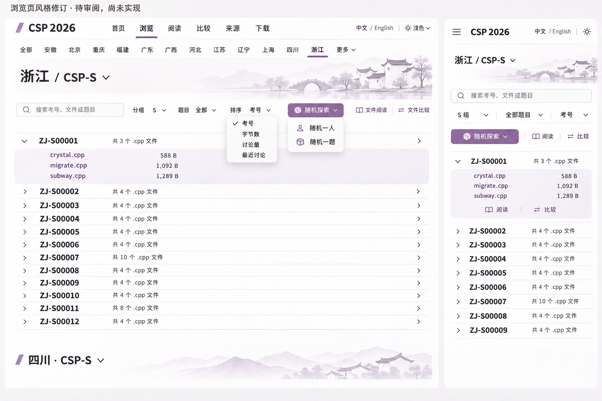
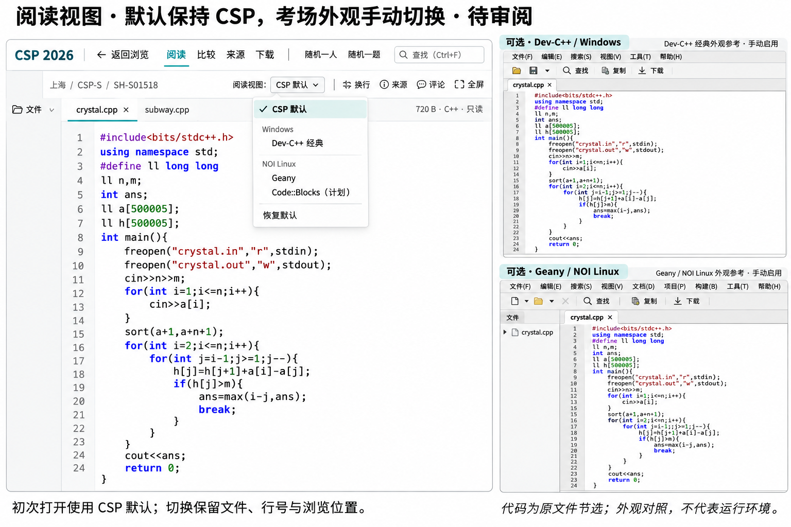

# CSP browser and reading-view review

Status: revised design proposal for human review; no new browser, reader or preset UI has been implemented. README, source attribution and licensing changes in this branch are concrete documentation changes. Existing `/code/` and `/preview/` remain the deployed experience.

The maintainer rejected the original narrow boxed province rail, permanent bottom provenance band, cramped mixed catalog/editor screen, low useful density, dated table styling and Shanghai-only national imagery. Those generated concepts are not approved targets. Later feedback asks for familiar editor ergonomics without cloning all of VS Code, and optional contest-editor views for Windows and NOI Linux, especially Dev-C++.

## Current visual review samples

These are visual discussion samples, not screenshots of a working feature. The regional sample has been revised using the maintainer-selected pale Shanghai skyline as an art-language reference: quiet, low-contrast, nearly monochromatic regional contours behind content. The bright tourist-postcard versions with pandas, palace cards and tea-garden cartoons are rejected. Different regions use different content in this restrained language; they do not inherit Shanghai landmarks. The default UI remains subject to review, and raised controls, repeated boxed forms and spreadsheet styling are not implementation targets. Actual implementation must use flat controls and bind archive paths, code, line numbers and metadata from the data model rather than reproduce image artifacts. The reading-view comparison uses shortened code to compare appearance; it does not prescribe an oversized editor font or an artificially narrow desktop viewport. Code space and real desktop/mobile readability need separate acceptance.
## One site, different reading tasks

The home introduces the national archive with useful entry points, real content previews and imagery representing multiple regions. The catalog is for scanning people/files and moving between region sections. The dedicated reader gives code the main space. Comparison uses a separate wide view. Provenance and downloads have their own full pages, with contextual entry points from a file. These tasks share navigation and state but do not have to fit one universal screen.

The catalog uses readable compact rows, alignment and useful metadata. A wrapping region selector replaces the skinny boxed vertical province list. Region sections can be read continuously with incremental loading, visible headings, keyboard navigation and a load-more fallback. Clicking a person or file opens the appropriate detail view; returning restores filters, selection and scroll position. A quick peek can supplement browsing but must not permanently squeeze the code into a narrow column.

Useful density is not tiny type, colored spreadsheet bands, bevelled buttons or a wall of outlined panels. Controls should be flat, hierarchy clear and row contents legible. The reference observations from real sites are specific: GitHub file navigation, the metadata rhythm of Hugging Face datasets, and the proportion of actual code in editor interfaces. Their branding, assets and statistics are not adopted as this project's content. Modernize the catalog by removing redundant per-row reading buttons and duplicated counts, simplifying filters into compact text controls, and using a clear type scale and alignment rather than a framed form-and-table shell.

## Default reader: borrow ergonomics, keep the project's design

The default remains a modern CSP reader. VS Code is the interaction reference, not a page to reproduce wholesale. Reuse familiar tabs, breadcrumbs, find, folding, resizable/collapsible file navigation, quick-open/command entry and a thin status bar where they help archive reading. Keep the editor flexible and dominant; hide supporting panels for focused reading. The existing implementation already uses Monaco with find, folding and bracket matching, so another runtime or a full IDE clone is unnecessary.

Random person/problem, archive source and discussion are CSP operations. They belong in discoverable compact commands or contextual panels rather than a large extra toolbar. Source details open on demand or on the provenance page; a permanent bottom legal/provenance stripe is rejected. Do not add decorative terminal, extension marketplace, debug or source-control controls that the archive does not provide. Do not use Microsoft's product branding as this project's identity.

Mobile is a dedicated single-column reader with a clear return action, file selection and compact commands. It must not be a shrunk desktop shell. Preserve readable code, an explicit wrap option and horizontal scrolling where appropriate. Switching reading views does not reset the source, location, selection or compare context.

## Optional contest-editor views

The reader has a separate **Reading view** selector. A fresh visitor gets **CSP default**, regardless of browser OS, region, file or entry link. Windows/NOI Linux are group labels for optional editor profiles, not automatically selected operating-system simulations. A saved explicit choice can be restored; **Reset to CSP default** remains obvious. Light/dark site theme and optional editor profile are separate preferences.

Dev-C++ on Windows is the priority. Match an explicitly identified reference's code font, syntax palette, tab/gutter treatment and compact editor chrome, with a classic Windows-style option where appropriate. Dev-C++ forks and releases differ; a vendor's current Embarcadero screenshot is not evidence of an exact Orwell 5.x installation. Label the profile as a reference-style reading view unless the precise version has been verified. Preserve actual archive bytes and code, and do not fill the screen with imitation compile/debug buttons.

NOI Linux profiles are tied to individual editors. Geany is the first directly inspected reference; Code::Blocks is a further planned profile whose visual reference still needs inspection. The official NOI Linux 2.0 release list also includes VS Code, Emacs, Gedit, Vim, Joe, nano and Sublime Text. Further profiles can be added after checking their real interfaces and finding a useful reading difference; this is not a promise that all have been implemented. Terminal-editor appearance does not imply a shell, Vim engine or Emacs runtime.

These profiles share the current code model and archive actions. They change presentation and selected reading affordances without recompiling, reformatting, changing encoding or executing a submission. Do not download IDE installers, Linux images, VMs or separate runtimes just to support a visual preset. Any implementation/assets borrowed from upstream projects require their own source and license review; a visual reference alone is not a dependency.

Primary references checked on 2026-11-09:

- [Live VS Code web](https://vscode.dev/) for actual workbench organization, and the existing Monaco integration in `website/src/editor.js`.
- [NOI Linux 2.0 release and software list](https://www.noi.cn/gynoi/jsgz/2021-07-16/732450.shtml), published 2021-07-16. It is the identified release reference, not proof of every school's current exam setup.
- [Embarcadero Dev-C++](https://www.embarcadero.com/free-tools/dev-cpp/) and its [official screenshot](https://raw.githubusercontent.com/Embarcadero/Dev-Cpp/master/Source/Images/screenshot800x600.png).
- [Geany's official screenshot gallery](https://www.geany.org/documentation/screenshots/), including its documented Geany 1.36 GNOME/GTK3 views.

## Random exploration and continuity

Random-person and random-problem are separate, discoverable actions with an explicit active scope. Random person uniformly samples eligible contestant-directory identities under the region/group/problem filters; sampling files would favor people with more files. In catalog context, random problem chooses an eligible problem and enters its archive. In a contestant reader, it chooses another available problem for that person. If jumping to an actual submission as a second step, make that selection scope explicit.

Prior/next person, prior/next problem and return history support continued reading after a random jump. Keep the filters visible, avoid an immediate repeat when an alternative exists, and explain empty or single-choice pools. Backups, malformed identities and duplicate directories must not silently bias the selection. User-facing language should describe the actual sampled unit rather than call every random file a random person.

## Sorting, metadata and in-page access

Region browsing sorts within each region. National results is a clearly identified flattened scope supported by complete sorted metadata, not just a reordered screenful. Candidate ID uses numeric-aware ordering and retains the original identifier, with a stable path tie-breaker. Byte size, filename, problem, discussion volume and recent discussion can answer useful follow-up questions. Filters for supported type, source availability, preview state or backups should appear where they help use; additions remain open to actual findings rather than a closed menu of requested examples.

The existing catalog stores `size: null` for most entries to avoid hydrating partial clones. Complete CI source-pack jobs already inspect blob sizes; publish those into pinned metadata there. Stored gzip bytes and expanded text size are separate measures. Text line/density metrics require successful bounded decoding. Unknown values sort last in either direction. A build timestamp is not a file modification timestamp; view counts are not invented.

Discussion threads, comments, replies and reactions are different measures. Retain the current stable file/case/pair discussion keys. A comparison discussion cannot be silently counted twice as independent per-file discussion. The 2026-11-09 API check returned zero Discussions, while the archive has 39 attributed comparison records. Complete empty data can support zero; synchronization failures or missing data are unknown/stale. Publish read-only timestamped metadata without putting an access token in frontend assets. [GitHub's Discussion schema](https://docs.github.com/en/graphql/reference/discussions) is the API reference; actual permissions and mapping still require implementation verification.

Source text, safe raster previews, metadata, citations, discussions and downloads should be accessible on the site. Identify source-named binary content by signature rather than displaying it as damaged C++. Bound text/image/gzip processing, and explain unsupported or oversized cases with an original download. Executables are never run. Archive listing or PDF/document previews need their own bounded implementation scope rather than an unverified feature promise.

## Regions have distinct identities

A national page represents multiple regions; Shanghai landmarks cannot stand for the whole archive. Each of the 29 cataloged regions needs an individually configured regional image and restrained accent within one coherent art direction. The imagery can draw on landscape, architecture, waterways or local visual texture. It is editorial identity, not an official emblem or an exclusive definition of a province.

The maintainer prefers the pale, receding skyline style of the original Shanghai example, while requiring other regions to retain their own identity. Use that as the art-language baseline, not bright tourism-poster cards. Extend the selected treatment to all cataloged regions. Do not merely recolor the Shanghai skyline. National composition should distribute attention across regions, and a new region should not inherit another province's illustration. Reading and comparison remain stable and neutral; regional art must not consume code space. Record asset origin and rights before shipping it.

## Sources and evidence

A file's GitHub URL identifies the archived copy, not its original publisher. Contextual provenance distinguishes publisher, supplied package, archived path, author/date/URL and the checks actually performed. Group/package records can be inherited with that scope. Attributed Luogu claims and independent byte/text observations remain separate. The two supplied-excerpt records lacking a permalink say so rather than invent one.

The proposed source page is a readable index with optional record previews. It links primary and supplementary materials, affected files, corrections and licensing scope. The original source-index and project-code license changes in this PR do not authorize relicensing contestant content. Public UI must not reproduce passwords or private correspondence from historical source records.

Concrete sample facts already checked: `SH/S/SH-S01518/crystal/crystal.cpp` is 720 bytes and `subway/subway.cpp` is 1,692 bytes; `SH/S/SH-S00952/hub/icon.png.cpp` is an actual 16,897-byte PNG entry. Zhejiang sample `ZJ-S00001` has three `.cpp` paths, crystal/migrate/subway, at 588/1,092/1,289 stored bytes. These are archive metadata, not judgments about official submissions or scores. Concept-image code and typographic artifacts are illustrative; implementation binds real paths and bytes rather than transcribing pixels.

## Review and implementation boundary

Next visual review should show a modern regional browsing direction and the same file under CSP default versus optional contest-editor profiles, particularly Dev-C++. Separate-page architecture, wide code space, both random actions, sorting scope, citations, mobile navigation and missing-data states remain in scope. Rejected boards do not become requirements just because they remain in history.

After explicit visual approval, implement the selected composition and ordinary fixes without repeated confirmation. Deploy the authorized review on a separate Pages path, preserving existing URLs and formal-homepage approval. Verify actual desktop/mobile Chinese typography and layout against the selected image, plus data ordering, random-selection units, state restoration, preset defaults and limits. Local tests, complete CI build, review deployment, actual download and external comment sign-in/posting are distinct outcomes.
