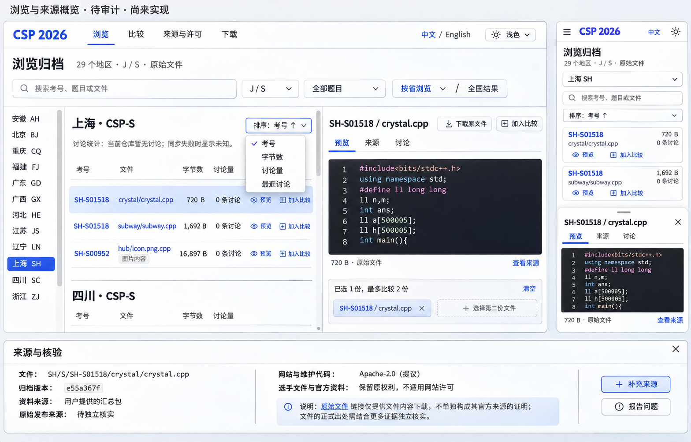

# Province browser and provenance review

Status: design proposal, not implemented. This document and its image are for the maintainer's audit before substantial UI changes. The existing code browser and `/preview/` remain the deployed experience. The separate README, licensing and source-index changes in this branch are concrete documentation changes.

## Start with the archive, keep the context

The main browsing screen should immediately expose real files. A compact header leads into search and browsing controls, with a scrollable region navigator on desktop. The main list is a continuous sequence of region sections; selecting a region jumps to its heading and updates the current location. Loading is incremental and bounded. Navigation, keyboard focus and a visible load-more fallback must work even without automatic scrolling.

Opening a file shows a neighboring preview while retaining the list's scroll position, filters and selection. On mobile the region navigator becomes a compact selector, and preview opens as a full-width sheet or detail view with an explicit return action. Returning restores the prior location. Two selections can be carried into the existing comparison workbench, then the user can return to browsing without starting over.

This expands the existing search/dropdown/pagination experience around an actual reading session. It does not remove the current comparison URLs or arbitrarily promote the project homepage. The final homepage remains subject to separate visual approval.

## Sorting has a defined object and scope

Region browsing sorts files within each region; national results is a separate flattened view with a clearly visible scope. Sorting a loaded screenful is not national sorting. Candidate ID uses numeric-aware ordering while retaining the original identifier and a stable path tie-breaker. Filename, problem and byte-size ordering make practical follow-up operations possible. Ascending/descending choices, result count and active filters remain visible and shareable in the URL.

Discussion activity follows real GitHub data: comment volume, last discussion activity and whether a discussion exists. Comments, replies, reactions and distinct discussion threads are different measures; a UI label must name the measure it actually uses. A comparison discussion belongs to the pair and must not be duplicated into independent per-file comments without explicit attribution. Existing file/case/pair discussion keys must be preserved during migration.

The current repository Discussions API returned **zero discussions on 2026-11-09**. The 39 attributed comparison records are not 39 live discussion threads. No popularity values should be fabricated. A successful complete empty snapshot can support zero; missing, failed or stale synchronization is shown as unknown or stale, not zero. Equal values use a stable path tie-breaker.

The current directory catalog stores `size: null` for most entries to avoid hydrating a local partial clone. The complete CI source-pack job already inspects blob sizes. The implementation should publish those sizes into versioned metadata in that complete environment, then produce bounded sorted indexes. Byte sizes refer to the actual stored file; gzip stored bytes and expanded text size are separate fields. Line counts and text-density measures are available only after successful bounded text decoding. Unknown and unsupported values sort last in either direction.

Searching and filtering should help answer questions that emerge during use. Available examples include file type, source availability, preview availability, backups, identical content and discussion state. These are reviewable extensions, not a closed feature list or a demand to add every conceivable control. The UI should keep frequent operations compact and reveal less common refinements when useful. Per-file historical modification dates or view counts are not currently available; do not label the build timestamp as a file modification time or invent view metrics.

## Most reading and verification should stay on the website

Syntax-highlighted text, byte metadata, attribution, the original-file link, a source record and comments should be accessible beside the selected file. Safe raster images can have an in-page preview when their content signature and bounds are known. Source-like filenames containing binary data must be identified from content, not misrendered as broken C++. Oversized, unsupported or unreadable content should explain the limit and offer the original download; executables are never run. Archive contents can be listed within extraction budgets, without automatically expanding nested archives. PDF/document support requires a separately bounded renderer and belongs in an explicit implementation scope rather than an unsupported promise.

The source panel distinguishes original publisher, supplied package, archived copy and verification performed. It retains author, date, original URL when known, affected paths and any unverified origin. An original-file GitHub link is not a substitute for an original publication citation. A source may cover a region/group or an entire package; files inherit the appropriate record rather than acquiring invented individual provenance.

For attributed discussion material, show the primary source, supplementary sources and independent observations together. The two supplied-excerpt records with no permalink explicitly say that the original link is missing. The full source index is available without opening a comparison. Source corrections and rights reports lead to an appropriate existing issue or private security route, without publishing credentials.

Search, empty results, loading, preview limits, missing source, stale comments, network errors, unsupported file types and mobile return navigation are part of the preview scope. They must be visible in the review deployment; a polished default screenshot alone is insufficient.

## Real reference pages and real example data

On 2026-11-09 the existing [CSP-2026 code browser](https://tangyixiao.github.io/CSP-2026/code/) and [project preview](https://tangyixiao.github.io/CSP-2026/preview/) were inspected in the browser, including the mobile download page, desktop comparison view and theme behavior. [GitHub Community Discussions](https://github.com/orgs/community/discussions) was inspected with its sort menu open to study the relationship between category navigation, results and activity. The [SH-S01518 directory](https://github.com/tangyixiao/CSP-2026/tree/e55a367faa8b689ad26e152af821fdfce43c24b1/SH/S/SH-S01518) was inspected for real file hierarchy. These are interaction references, not copied branding or claims of affiliation.

The overview uses actual archived identities and stored sizes: `SH/S/SH-S01518/crystal/crystal.cpp` is 720 bytes, `SH/S/SH-S01518/subway/subway.cpp` is 1,692 bytes, and the recorded `SH/S/SH-S00952/hub/icon.png.cpp` is 16,897 bytes. The code sample is a short excerpt from the first file. The displayed zero-comment state reflects the empty repository snapshot, not a working future count synchronizer. Any image-generation typography or filename artifact is illustrative; implementation must use the actual catalog strings rather than transcribe pixels.

The palette extends the existing restrained blue and slate presentation, with a light catalog and dark code area. Display and controls use readable Chinese system typography, code uses a monospace face, and file metadata remains smaller but legible. The signature is the province-to-province reading flow with a persistent preview, not a decorative hero. Mobile is a distinct single-column composition.

## Data, delivery and audit boundary

Reuse the current catalog, source snapshots, downloads, Monaco and giscus. Do not introduce a new frontend framework or a second archive. Complete-build jobs can emit byte metadata and a read-only, timestamped discussion snapshot; no GitHub access token belongs in public assets. GitHub's [Discussion schema](https://docs.github.com/en/graphql/reference/discussions) supplies the activity and comment connections, but the repository's actual token permissions and stable-key mapping must be verified in implementation. Metadata synchronization failure must not prevent browsing a complete archive snapshot.

Implement approved interactions on an isolated Pages review path, preserving existing entry points and share links. Acceptance compares desktop and mobile captures with the approved composition and exercises real Chinese typography, spacing, navigation, sorting scope, missing/stale metadata and return position. Verify ordering against data, not the shape of a select menu. CI/build, preview deployment, visitor comment authentication and actual download are separate checks.

No substantial browsing UI has been implemented in this branch. The maintainer should audit the composition, reading flow, sorting semantics and provenance display before implementation. The proposal remains open to useful additions found during actual use; additions that change the approved visual direction or authorized scope return for review, while routine implementation and fixes continue without repeated confirmation.
