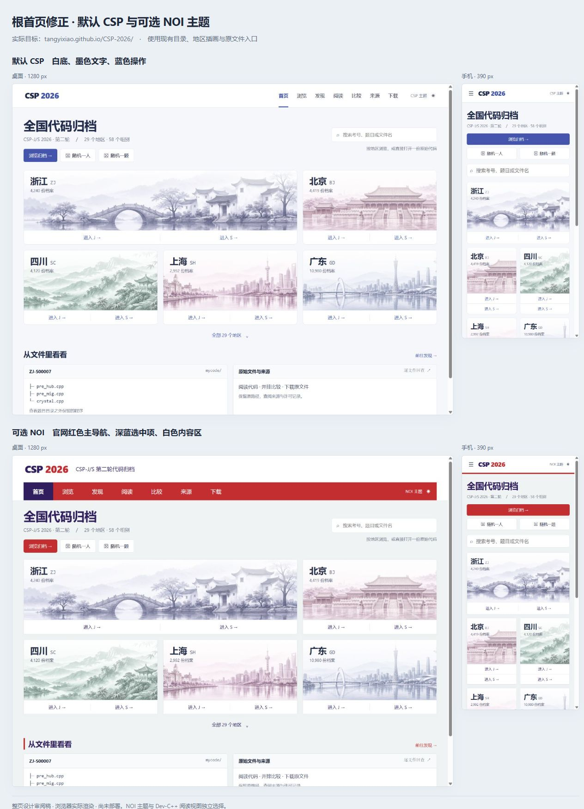
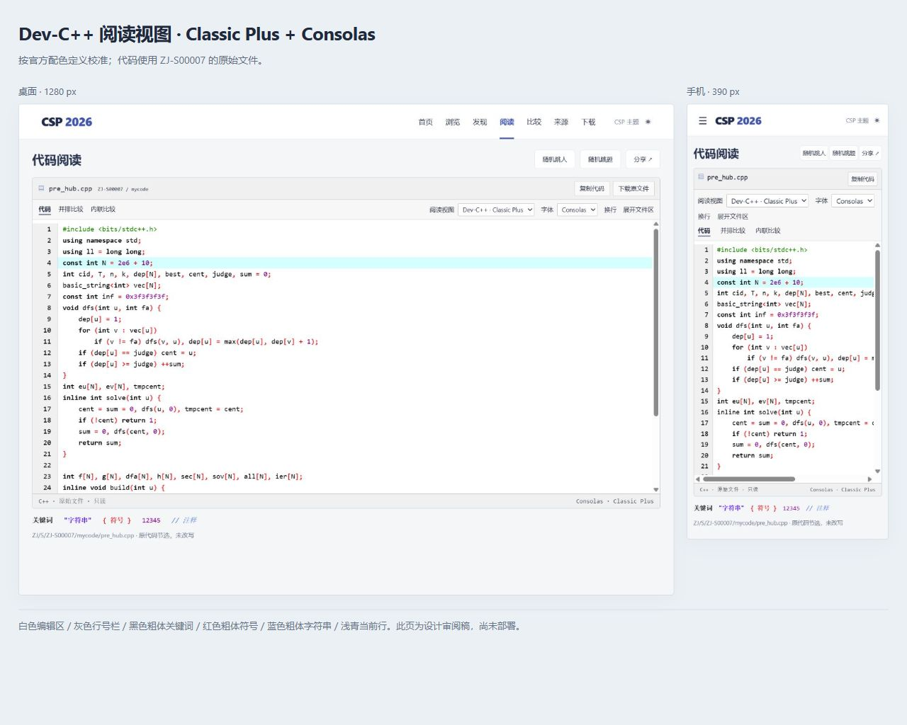

# Root homepage, NOI appearance and Classic Plus

The maintainer explicitly approved these corrected desktop/mobile compositions on 2026-11-10. They supersede the global lavender direction and the earlier decision to preserve the old root homepage. The principal design skill was `frontend-design`; the boards were rendered from an HTML/CSS prototype with the project's regional assets and real archive content, rather than generated application screenshots.

The target homepage is the actual `/CSP-2026/` root. Earlier changes to `code/browse.html` did not alter it because packaging continued to copy `landing/index.html` into the root. The corrected root must contain the new composition itself, with working project-relative links, search, region selection and random-action handoff. The existing documentation, reader, source snapshots and downloads remain linked from it. Root counts derive from the validated catalog, with directory identities kept distinct from people or official submissions.

The default CSP appearance uses white surfaces, ink text and blue actions. Regional scenes retain their own muted colors. NOI is a separately selectable site appearance, based on the official homepage visually inspected on 2026-11-10: red navigation `#D22525`, dark navy active state/headings `#29255C`, a separate masthead, white content panels and pale gray background. The project's own name and content remain visible; official logos, news images and institutional claims are not included. Mobile controls collapse into a working menu, rather than a narrow province strip.

The optional Dev-C++ reader uses Classic Plus with the maintainer's requested Consolas font. Its palette is grounded in the pinned official source definitions listed in [SOURCES.md](../../SOURCES.md): white editor, gray gutter, black bold keywords, red bold symbols, blue bold strings, green preprocessor, purple numbers and italic system-highlight comments. The current-line color is light cyan `#CCFFFF`, interpreting Delphi's BGR value correctly. Windows system colors need explicit web approximations. A dark adaptation, if selected, is a project adaptation, not a historical official dark Classic Plus preset.

Site appearance, light/dark choice and reading profile are independent. CSP remains the default profile; selecting Dev-C++ applies Classic Plus and Consolas. Switching presentation must retain the original text, active file, selection and reading position. No compiler or execution environment is provided by these presentation options.

Validation must compare the actual root and subpages with these boards at 1280 and 390 pixels, including Chinese typography, regional image crops, the optional red navigation, real source highlighting and code space. Root search and both random actions must reach functioning browser/reader states. Functional tests, complete archive CI, merge, deployment and live visual verification are recorded separately in the change's PR and workflow results. Generated output must retain the complete source-snapshot checks; a partial local checkout is not a reason to hydrate the full archive.

## Implementation evidence

The local integration preview mounts the actual root template, homepage resources and browser at the same `/CSP-2026/` path prefix used in production. The root renderer and browser use the existing pinned catalog; source previews stream already-published byte buckets on demand and retain Git object verification. No complete archive copy was downloaded locally.

The final local test run passed 69 Node checks, including real Monaco tokenization and Classic Plus style resolution, model bracket-color restoration, root project-relative links, unknown-count behavior and theme independence. The bounded Vite frontend build passed with the existing Monaco size warning. Browser checks exercised root search, both national random handoffs, all 29 region entries, direct region/reader links and the optional NOI appearance. A full archive CI build and deployment remain separate checks in the PR/workflow records.

- [Actual root, default desktop](runtime-root-home-csp-desktop.png) and [phone](runtime-root-home-csp-mobile.png)
- [Actual root, NOI desktop](runtime-root-home-noi-desktop.png) and [phone](runtime-root-home-noi-mobile.png)
- [Actual Classic Plus desktop](runtime-classic-plus-desktop.png) and [phone](runtime-classic-plus-mobile.png)

These runtime captures show real archive content, not the earlier design prototype. The Classic Plus palette was also checked in the rendered DOM because Monaco's bracket-color decorations can override otherwise-correct token colors.

The phone source example opens focused by default: at 390 px its code begins near y=256, with Consolas 14 px / 22 px retained. The reader menu expands all seven navigation entries, while single-file view removes repeated source-path and mode labels. Mobile profile switches retained identical rendered code text, and wrapping kept the page within the viewport. These checks used UI actions and rendered DOM, without running contestant programs.
